## From textbook to my own simulator

While learning physics simulation, I have always wondered how the equations of motion in a textbook become a program that actually runs. Take a rod bending under gravity: the program needs to calculate the forces on each node, determine how the material deforms, and decide how to update positions and velocities at every time step.

I started with the [Physics-Based Simulation](https://phys-sim-book.github.io/) textbook and its [Python tutorial](https://github.com/phys-sim-book/solid-sim-tutorial), first studying computational cost with a 2D mass-spring scene. I wrote up the comparisons among Python, C++, and different solver paths in [my previous 2D mass-spring benchmark article](https://maojunxiang.divinechime64.chatgpt.site/blog/physics-solver-benchmark/). Those experiences led me to implement a 3D solid simulator of my own.

Here, “simulator” means a program that discretizes the equations of motion for a continuum into algebraic equations a computer can solve, then advances the solution through time. **fiction is a 3D solid simulator written primarily in C++20, currently focused on hyperelastic solids.** It is not a general-purpose finite element package; it is a small experimental project I built while learning, mainly to practice and to work through the textbook methods end to end.

Technically, it discretizes objects into tetrahedral meshes, computes the energy, gradient, and Hessian (the second derivative of energy with respect to nodal coordinates) of a Neo-Hookean material for each element, and assembles these local contributions into a global system. Time integration uses implicit Euler, with projected Newton and a sparse linear solver to find the new positions at each step. It currently does not handle contact, plasticity, or fluids. Its structure is simple and easy to modify, making it convenient to add materials, scenes, and numerical checks.

To see how these components work together, we can first follow one time step, then examine the material calculations and time update separately. After that, we can let them work together on a rod, moving from stretching to bending and twisting, and finally switch to more complex geometry and multiple objects.

## Inside one time step in fiction

Imagine a rod fixed at its left end and bending under gravity. Given the position and velocity of every node at the current time, the next task is to find the shape after a short interval. The left end must stay at its prescribed position; the other nodes continue moving through inertia and are also affected by elasticity and gravity. How does fiction include all these requirements in the same calculation?

Write the positions and velocities of all nodes as the vectors $x^n$ and $v^n$, respectively, and denote the time step by $h$. First consider inertia alone: let every node move for one step at its current velocity to obtain the inertial prediction:

$$
\widetilde{x}=x^n+h v^n.
$$

This predicted position gives the solver a reference: in the absence of other forces or boundary constraints, the node would move there. Elasticity and gravity pull it toward a new equilibrium. For a dynamic scene, fiction writes the new position as the following optimization problem:

$$
\Phi(x)=\frac{1}{2}(x-\widetilde{x})^T M(x-\widetilde{x})
+h^2\left(U_{\mathrm{elastic}}(x)+U_{\mathrm{gravity}}(x)\right)
+\Phi_{\mathrm{DBC}}(x).
$$

Here, $M$ is the lumped mass matrix. The first term measures how far the new position deviates from the inertial prediction; the second is the elastic and gravitational potential energy weighted by $h^2$; and the final term, $\Phi_{\mathrm{DBC}}$, is a penalty term for a prescribed-position boundary condition (Dirichlet boundary condition, DBC). This objective corresponds to the implicit Euler update: the inertia term pulls the new position toward the predicted position, while the potential energy is evaluated at the new time. The goal is to find an $x$ that minimizes $\Phi$; in practice, iteration stops once the specified stopping condition is met. After obtaining $x$, velocity is updated using $v^{n+1}=(x-x^n)/h$.

First, consider an example we can calculate by hand. Suppose there is a single unconstrained particle whose vertical coordinate points upward. Its initial position and velocity are both zero, it is subject only to gravity, and the gravitational acceleration has magnitude $9.81\,\mathrm{m/s^2}$. Let $h=0.005\,\mathrm{s}$; the inertial prediction remains zero. Substituting gravitational potential energy into the expression above and finding the stationary point gives a position after one step of $-9.81h^2=-0.00024525\,\mathrm{m}$, or about **0.245 mm** downward.

Implicit Euler uses the velocity at the new time to calculate displacement over the whole time step, so the first-step drop is larger; over the same interval, continuous free fall gives a drop of about 0.123 mm. The two differ because the former is a discrete solution at a fixed time step, while the latter is the continuous solution to this idealized problem.

Figure 1 places the inertial prediction, continuous motion, and one-step implicit Euler result on the same displacement scale, so their positions can be compared directly.

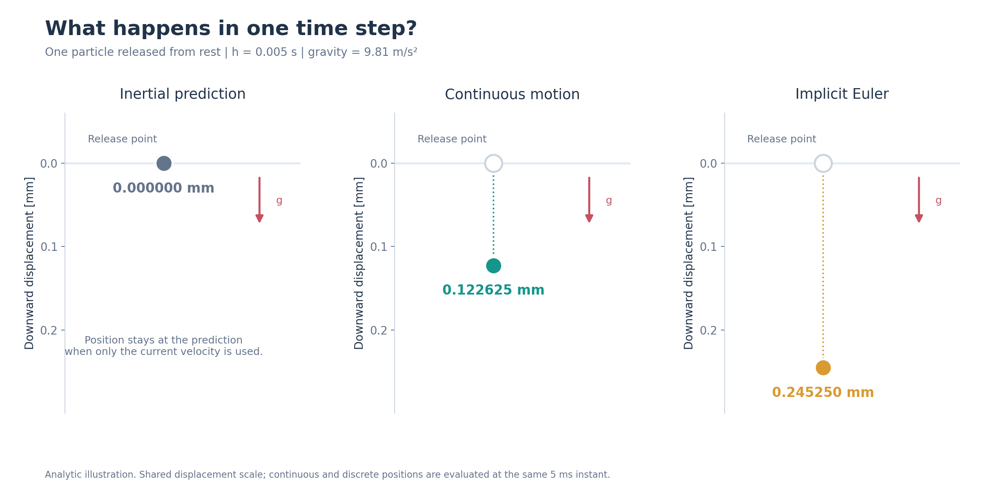

*Figure 1: Positions of a particle released from rest after 5 ms. The three panels show the inertial prediction, continuous free fall, and the analytical implicit Euler result, respectively. The vertical axis is downward displacement in mm in all panels.*

A real rod consists of many tetrahedra, whose nodes interact through material energy, so its solution cannot be written down directly like that of a single particle. At the current configuration, fiction computes the objective's gradient and Hessian, solves a linear system for an update direction, and then uses a line search to decide how far to move along that direction. If a trial position does not decrease the objective, the program reduces the line-search step size and tries again. After accepting an update, it continues iterating until the stopping condition is met.

Large material deformations can cause the original Hessian to have negative eigenvalues, so the search direction computed from it is not necessarily a descent direction. fiction's Neo-Hookean tetrahedron implementation applies a positive semidefinite (PSD) projection to each element's local Hessian, then assembles the results into a global sparse matrix. The projected matrix is used only to compute the update direction; the energy and gradient still come from the original material model.

The fixed end also participates in the solve. fiction first applies a penalty to nodes that have not yet reached their target positions; once a node's error satisfies the specified condition, the corresponding degree of freedom is eliminated from the search direction. The fixed end's target position remains constant; in a twisting scene, target positions can instead vary over time. If the boundary penalty stiffness is increased during the solve, the program recomputes the objective, search direction, and constraint satisfaction so that all three continue to correspond to the same optimization problem. Each time-step solve also records the iteration count, stopping reason, and constraint error, making it possible to inspect what happened inside that step.

| Symbol | Meaning |
|---|---|
| $x^n,v^n$ | Position and velocity at the current time |
| $h$ | Time step |
| $\widetilde{x}$ | Inertial prediction position based on the current velocity |
| $M$ | Lumped mass matrix |
| $U_{\mathrm{elastic}},U_{\mathrm{gravity}}$ | Elastic and gravitational potential energy |
| $\Phi_{\mathrm{DBC}}$ | Penalty term for the prescribed-position boundary condition |

Static solves use the same framework, but omit the inertia term and directly seek the equilibrium shape under the given loads.

## Putting the material into tetrahedra

The time step above combines inertia, material, and boundaries in one objective. The material energy comes from local calculations on each tetrahedron. A 3D rod is assembled from many tetrahedra. For one tetrahedron, the positions of its four vertices are known in both the reference and current configurations, from which we can construct the deformation gradient $F$. It describes the element's stretch, shear, and rotation from the reference configuration to the current one. The Neo-Hookean material uses $F$ to compute the element's elastic energy, and the contributions from all elements are accumulated into the global system by node index.

The material must provide its energy, gradient, and local Hessian for assembling the solve matrix. fiction organizes these operations in the `IEnergy` interface: the material describes the local physical response, while the time integrator combines it with inertia, gravity, and boundary conditions. This separation lets us check a new material in stages: first validate the element on its own, then observe its behavior during a complete time step.

### Checking one element and its assembly

The detailed checks start with one tetrahedron. Apply stretch, shear, and compression in turn; estimate the first and second derivatives of energy with respect to nodal positions using finite differences; then compare them with the gradient and original Hessian computed by the code. Each configuration uses four finite-difference step sizes from $10^{-4}$ to $10^{-7}$, for 12 groups in total. The maximum relative gradient error is about $4.61\times10^{-8}$, and the maximum relative Hessian error is about $1.66\times10^{-8}$.

Figure 2 shows the tetrahedron configurations used in these checks. The material formula stays the same; what changes is the relative position of the four vertices.

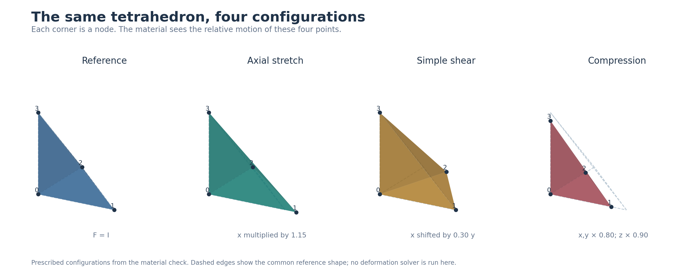

*Figure 2: Reference, axial-stretch, simple-shear, and compression configurations. Solid points mark the current nodes, and dashed lines mark the common reference edges. The deformation matrices come from the prescribed configurations used in the material checks.*

These checks also cover translation and rotation of the reference configuration, a superimposed rigid rotation after deformation, different Young's moduli and Poisson's ratios, and assembly of two joined tetrahedra. The PSD projection is checked separately: the projected matrix is compared with an independent reconstruction from eigendecomposition, and the original Hessian is confirmed to have negative eigenvalues under shear and compression. After projection, only negative values at the scale of floating-point rounding remain. This makes it possible to inspect the material's true second derivatives separately from the curvature approximation used by the solver.

### Checking the time update with a linear oscillator

The element checks examine the material response at a given shape. Next, we also need to see how forces change motion through the time update. For this, I chose a small system with a known reference trajectory: a mass attached to a linear spring with stiffness 20, masses of 1, 2, and 5, and time steps of 0.01, 0.02, and 0.04 s. Each combination is advanced for 120 steps. The reference trajectory is independently computed from the implicit Euler update equations starting from the initial state, then compared step by step with the positions and velocities output by the program. Across the nine groups, the maximum cumulative position difference is about $8.94\times10^{-15}$, and the maximum velocity difference is about $4.02\times10^{-14}$.

Figure 3 shows the oscillator scene on the left and a phase trajectory assembled from the saved positions and velocities on the right. The trajectory contracts inward, indicating that oscillation energy gradually decreases.

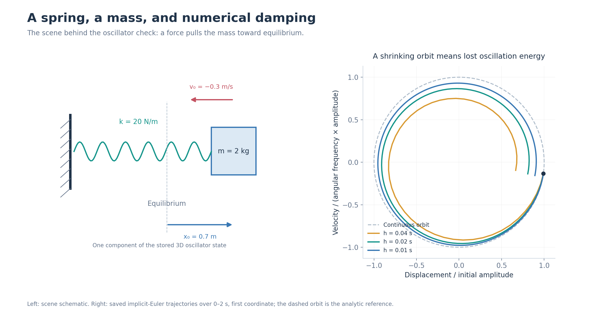

*Figure 3: Spring oscillator scene and phase trajectory. The right panel uses the first coordinate for a mass of 2 kg and compares three time steps over 0–2 s. The dashed circle is the continuous reference orbit, and the solid curves come from the saved numerical trajectories.*

The same oscillator can also show how the time step affects motion. Fix the mass at 2 and compare the numerical trajectory with the continuous oscillator solution over 0–2 s. As the time step decreases from 0.04 s to 0.02 and 0.01 s, the maximum dimensionless state error over the interval is about 0.324, 0.179, and 0.094, respectively; the ratio of final to initial energy is 0.452, 0.671, and 0.819.

The state error compares position and velocity together. Let $\omega=\sqrt{k/m}$. Normalize position by $L_0=\max(\lVert x_0\rVert_\infty,\lVert v_0\rVert_\infty/\omega)$ and velocity by $\omega L_0$, then take the maximum of the two differences across all components and sample times. With smaller time steps, this example retains more of its oscillation energy. The dynamic cantilever later also shows the relationship between time step and oscillation trajectories.

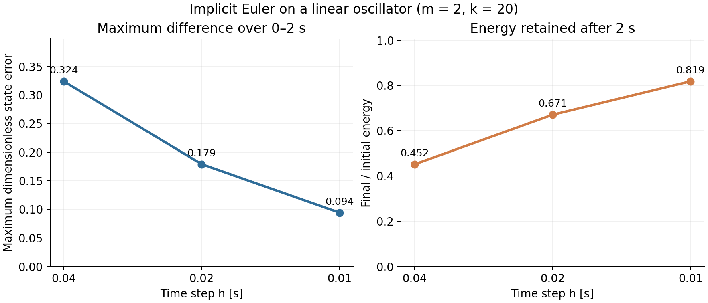

*Figure 4: State differences and energy ratios for a linear oscillator over the same physical duration of 2 s, using three time steps. The time step is halved from left to right. The left panel shows the maximum dimensionless state difference from the continuous oscillator solution over the 0–2 s sampling interval; the right panel shows the ratio of energy at 2 s to the initial energy.*

## Uniformly stretching a rod

After checking the material's local calculations and the time update on a simple system, we can bring multiple elements, global assembly, and boundary conditions together. We start with uniform stretch: I put the material in a 3D rod 1 m long with a 0.05 m × 0.05 m cross section. The rod uses a Neo-Hookean material with $E=10^6\,\mathrm{Pa}$ and $\nu=0.3$. Displacement boundaries corresponding to uniform stretch are applied at both ends, and the solver determines the middle nodes. The axial stretch ratios are set to 1.00, 1.01, 1.02, and 1.05, where 1.00 means no stretch and 1.05 means 5% elongation.

Figure 5 shows the reference shapes for the four stretch levels: the right end moves progressively outward, while the lateral dimensions shrink according to the prescribed affine target.

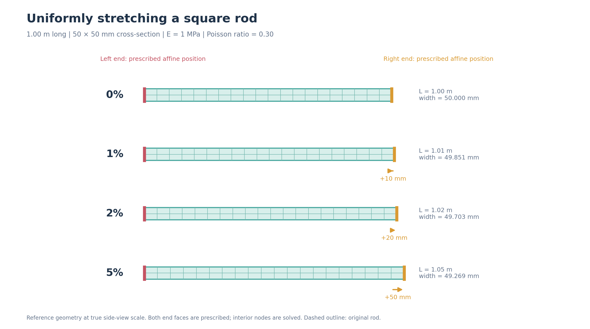

*Figure 5: Reference geometries for four uniform stretch levels, shown at a consistent side-view scale. The complete affine positions at both ends are prescribed by the boundary conditions, while the solver determines the middle. Lateral dimensions use the reference stretch factors in the run records; dashed lines show the original shape.* [View an animation of the four stretch settings](assets/scenes/03-uniform-rod-stretch.gif) (switches between loading cases).

I use three meshes, from coarse to fine, denoted M1, M2, and M3, with 99, 525, and 3,321 nodes, respectively. Each mesh is evaluated at all four stretch ratios, comparing position, reaction force, energy, and element volume ratio. All 12 mesh/stretch-ratio combinations completed this set of checks. The Newton iteration counts under nonzero stretch are:

| Mesh | 1% elongation | 2% elongation | 5% elongation |
|---|---:|---:|---:|
| M1 | 18 | 20 | 14 |
| M2 | 21 | 24 | 15 |
| M3 | 23 | 24 | 16 |

For M3, the maximum relative energy difference under the three nonzero stretch levels is about $2.67\times10^{-8}$, and the maximum relative reaction-force difference is about $1.38\times10^{-8}$. The first three stretch ratios use an initial DBC penalty stiffness of $10^8$, while the 5% stretch uses $10^{10}$. During the solve, the penalty stiffness is adjusted according to how well the boundary conditions are satisfied. These results jointly test the material calculations, global assembly, and displacement boundaries at both ends.

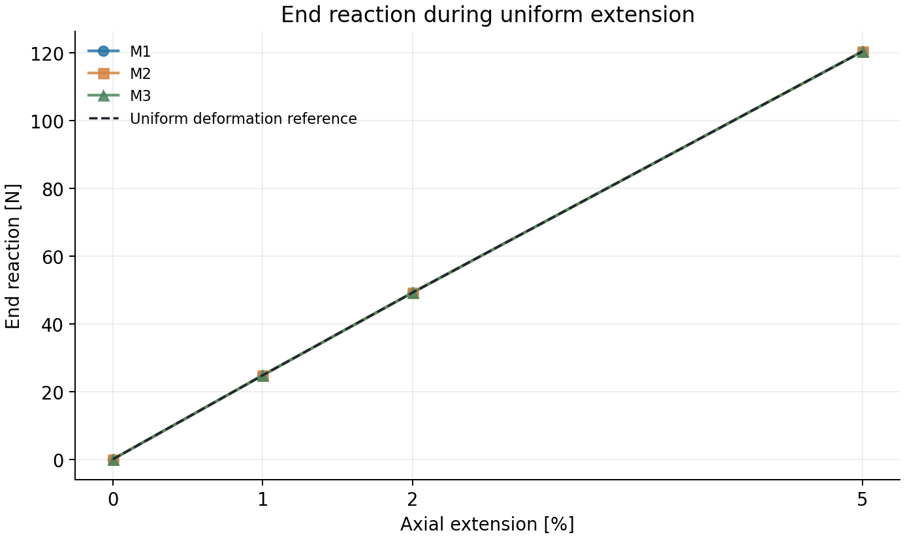

*Figure 6: Axial elongation and end reaction force in the uniform-stretch experiment. The M1, M2, and M3 results nearly overlap the uniform-deformation reference in the plot; each point corresponds to 0%, 1%, 2%, or 5% elongation.*

## Spatial and temporal experiments with a cantilever beam

Displacement under uniform stretch changes affinely, which a linear element can represent directly. Bending requires stretches, compression, and rotation at different positions to work together, making the effect of mesh resolution easier to see. Next, using the same square rod dimensions, we examine how both the spatial mesh and the time step change the results.

### How far does the beam bend as the mesh is refined?

Start with static equilibrium. The cantilever is 1 m long with a 0.05 m × 0.05 m cross section. Its left end is fixed, and the rest bends under gravity until it reaches equilibrium. The beam uses a Neo-Hookean material with Young's modulus $E=5.90\times10^8\,\mathrm{Pa}$, Poisson's ratio $\nu=0.3$, and density $1000\,\mathrm{kg/m^3}$. I focus on the average downward displacement of the free end, or tip deflection. Under small-deformation Timoshenko beam theory, the tip deflection for these conditions is about **10.002 mm**. It includes both bending and shear, and serves as a reference line.

Figure 7 marks the fixed end, free end, and gravity direction, and shows the beam shape in three saved states.

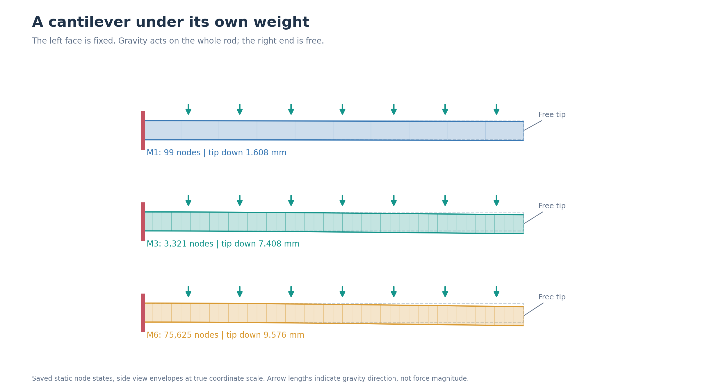

*Figure 7: Side profiles of the static cantilever. The red line marks the fixed end, and the arrow shows the direction of gravity acting on the entire beam. The three panels use saved nodal states from coarse, medium, and fine meshes; displacement is not exaggerated.*

To observe the effect of spatial discretization, I progressively refine the tetrahedral mesh from M1 to M6. The six data sets below all use `tol=1e-8`. Relative difference is defined as the difference between tip deflection and 10.002 mm, divided by 10.002 mm.

| Mesh | Nodes | Tetrahedra | Tip deflection | Difference from beam reference |
|---|---:|---:|---:|---:|
| M1 | 99 | 240 | 1.608 mm | 83.92% |
| M2 | 525 | 1,920 | 4.250 mm | 57.51% |
| M3 | 3,321 | 15,360 | 7.408 mm | 25.94% |
| M4 | 10,309 | 51,840 | 8.620 mm | 13.82% |
| M5 | 23,409 | 122,880 | 9.151 mm | 8.51% |
| M6 | 75,625 | 414,720 | 9.576 mm | 4.26% |

Across the six meshes, tip displacement increases with refinement, and the difference from the beam-theory reference drops from 83.92% to 4.26%. For example, refining from M3 to M6 increases tip deflection by about 2.169 mm; from M5 to M6, it increases by about 0.425 mm. This shows that tetrahedral mesh resolution has a substantial effect on the bending shape.

In addition to mesh resolution, I recorded results for the same M3 mesh under different solver settings. The initial M3 run used `tol=1e-10`. At the 100-iteration limit, tip displacement was 7.40750851 mm, and the infinity norm of the free-node force residual was about $1.23\times10^{-7}\,\mathrm{N}$. A later run used `tol=1e-8`; its tip displacement was 7.40750861 mm, a difference of about $1.04\times10^{-10}\,\mathrm{m}$ between the two results.

In the M3 comparison after switching to the `combined` stopping criterion, tip displacement at the end of iteration 6 was 7.40750850694 mm. The maximum position difference across all nodes from the final state of the initial run was about $1.27\times10^{-12}\,\mathrm{m}$. The iteration counts differ greatly, but the resulting shapes almost completely overlap. The following sections discuss the effects of spatial discretization and the stopping criterion separately.

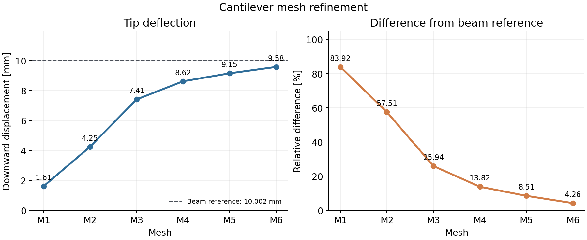

*Figure 8: Tip deflection and relative difference from the beam reference for six static cantilever meshes. The dashed line is the small-deformation beam reference of about 10.002 mm. All six results come from the `tol=1e-8` mesh-refinement batch.*

### Why is the beam stiffer on a coarse mesh?

The shapes in Figure 7 and the deflection curve in Figure 8 point to the same pattern: the coarser the mesh, the stiffer the beam's response. To understand why, consider how a tetrahedron represents displacement. fiction uses linear (P1) tetrahedra: displacement is interpolated by a first-degree function within each element, so the element's deformation gradient and small strain are constant. Bending requires richer spatial variation. For a short beam segment bending at constant curvature in the $xz$ plane along the $x$ direction, for example, displacement can be written as:

$$
u_x=-\kappa xz,\qquad u_z=\frac{\kappa x^2}{2},
\qquad \varepsilon_{xx}=-\kappa z,
\qquad \gamma_{xz}=\frac{\partial u_x}{\partial z}+\frac{\partial u_z}{\partial x}=0.
$$

Here, $\kappa$ is curvature and $z$ is the position across the section. One side of the beam is in tension and the other in compression. The derivatives of the two displacement components must also cancel exactly to produce pure bending without shear. A single linear tetrahedron cannot fully represent the quadratic and cross terms here; many elements must work together to approximate this shape. A coarse mesh limits the displacement modes that can be represented, so the same gravity produces less bending. As more elements are added, the beam gradually becomes easier to bend. The excessive stiffness of linear tetrahedra in bending, and the need for a finer mesh, are common characteristics of this type of element.

The static cantilever experiment directly solves for static equilibrium: the code removes the inertia term and sets the weights on material and gravitational potential energy to 1. Thus, the change in deflection here reflects spatial discretization. The tip difference between the two M3 runs with different `tol` values is about $1.04\times10^{-10}\,\mathrm{m}$, while the difference between the same mesh and the beam reference is about $2.595\times10^{-3}\,\mathrm{m}$—roughly 25 million times larger. Tightening the stopping tolerance for this solve has far less effect on the bending shape than increasing the number of spatial degrees of freedom.

We can also ask: is this “first-order convergence”? In finite elements, a “first-order element” means that its interpolation polynomial has degree 1. For smooth, stable standard problems, P1 elements typically have first-order error reduction with mesh size in the $H^1$ norm and second-order reduction in the $L^2$ norm. Here, however, the measured quantity is the average nodal displacement at the free end, which is not defined by either of these domain norms.

Let the spatial scale be $h_s=L/n_x$, where the axial segment counts $n_x$ of the six meshes are 10, 20, 40, 60, 80, and 120, respectively. Let $e_i$ denote the absolute difference between the tip value and the beam reference. Using $p_{\mathrm{obs}}=\log(e_i/e_{i+1})/\log(h_{s,i}/h_{s,i+1})$, the observed orders between adjacent meshes are **0.55, 1.15, 1.55, 1.68, and 1.71**, respectively. The last few intervals gradually approach 1.7.

The 10.002 mm reference consists of about 9.976 mm from bending and 0.026 mm from shear, using a small-deformation Timoshenko beam approximation. fiction solves a 3D Neo-Hookean continuum, with constraints also applied to 3D nodes at the fixed end. Therefore, the observed order here describes how the difference from this beam reference decreases; it includes both mesh effects and differences between the two continuum models, so it cannot be directly treated as the convergence order of the 3D equations.

### When does the solver stop iterating?

Mesh refinement explains why the shape changes. The earlier M3 comparison shows another phenomenon, though: the shape has almost stopped changing, but the solver keeps iterating. To understand this, we need to look inside each equilibrium solve at the search direction, actual movement, and remaining force separately.

The Newton linear system gives the search direction $p_N$; line search selects a coefficient $\alpha$, and the accepted position change is $\Delta x=\alpha p_N$. If the objective can hardly be reduced further at floating-point precision, line search may shrink $\alpha$ to a very small value. The actual position barely moves, even though the original search direction remains above its threshold. Thus, “a small search direction” and “a small actual movement” answer different questions. A small actual movement may also result from line-search stagnation, in which case we must also check how much unbalanced force remains in the equations.

The material and gravitational potential energies in a dynamic objective are multiplied by $h^2$. Removing the DBC penalty and taking only the free nodes, the objective gradient is:

$$
g_f=\left[M(x-\widetilde{x})+h^2\nabla U(x)\right]_{\mathrm{free}},
\qquad
r_f=\frac{g_f}{h^2}
=\left[M\frac{v^{n+1}-v^n}{h}+\nabla U(x)\right]_{\mathrm{free}}.
$$

$r_f$ is the force residual in the discrete equations of motion, with units of N. Static mode has no $h^2$ weight, so in that case we directly use $r_f=g_f$. This puts residuals from different time steps on a common dimensional scale. In the dimensional check described in the records, at $h=0.005$, $0.01$, and $0.02\,\mathrm{s}$, the infinity norms of the raw gradients are $2.5\times10^{-5}$, $10^{-4}$, and $4\times10^{-4}$, respectively. Dividing each by its own $h^2$ gives **1 N** in all three cases.

The current implementation provides four stopping modes, with `step` still the default. Let $S$ denote the search-direction condition, $A$ the consecutive small-displacement condition, and $G$ the relative force-residual condition. They are defined as follows:

| Condition | Definition | Test |
|---|---|---|
| $S$ | For dynamic solves, $\lVert p_N\rVert_\infty/h$; for static solves, $\lVert p_N\rVert_\infty$ | No greater than `tol` |
| $A$ | Accepted $\lVert\Delta x\rVert_\infty$ | No greater than `actualStepTol` for `actualStepCount` consecutive iterations |
| $G$ | $\lVert r_f\rVert_\infty/F_{\mathrm{scale}}$ | No greater than `gradTolRel`; force scale is passed through `gradScale` |

`step` uses $S$, `grad` uses $G$, and `actual` uses $A$; `combined` uses **$S\ \mathrm{OR}\ (A\ \mathrm{AND}\ G)$**. All four modes require the prescribed-position boundary conditions to be satisfied. This “or” retains the original exit condition of “small enough search direction” and adds another exit for the state where “position has stopped changing and the remaining force is small enough”; the force-residual check belongs to this second branch.

The M3 comparison retains the original `tol=1e-10` and explicitly sets `gradTolRel=1e-6`, `gradScale=24.525 N`, `actualStepTol=1e-12 m`, and `actualStepCount=2`. This sets a force-residual threshold of $2.4525\times10^{-5}\,\mathrm{N}$ for the alternate branch. At iteration 6, the maximum force residual on free nodes is about $1.23\times10^{-7}\,\mathrm{N}$, while the search-direction measure remains about $1.06\times10^{-9}$. The consecutive small-displacement and force-residual conditions cause `combined` to stop at this state. The default `step` reproduces the original 100-iteration record. The final positions from the two runs agree to about $10^{-12}\,\mathrm{m}$, while the difference in tip deflection from the beam reference remains about 25.94%.

| Symbol | Meaning |
|---|---|
| $h_s,n_x$ | Spatial mesh scale and number of axial segments; $h$ still denotes the time step |
| $u_x,u_z,\kappa$ | Two components of ideal bending displacement and curvature |
| $\varepsilon_{xx},\gamma_{xz}$ | Axial normal strain and engineering shear strain in the small-strain setting |
| $p_N,\alpha,\Delta x$ | Newton search direction, line-search coefficient, and accepted position change |
| $U,g_f,r_f$ | Total elastic and gravitational potential energy, free-node objective gradient, and free-node physical force residual |
| $F_{\mathrm{scale}}$ | Characteristic force scale supplied by the caller |

These settings and the final-state comparison show that the stopping criterion changes when the solve ends, not the spatial discretization error itself. The former describes the state reached by the current discrete equations; the latter describes how the shape changes when the discretization space is refined.

### How does the bending trajectory change when the time step is reduced?

So far, we have solved for static equilibrium; next, we bring time integration back and observe the rod bending and rebounding. The dynamic cantilever experiment uses the same 1 m × 0.05 m × 0.05 m rod geometry, with the left end fixed, and suddenly applies gravity from an initially stationary state. The material parameters are $E=4.40\times10^7\,\mathrm{Pa}$ and $\nu=0.3$, and the density remains $1000\,\mathrm{kg/m^3}$. I continued to record the mean downward displacement of the free end.

First, I advanced the M2 mesh for 2000 steps with $h=0.005\,\mathrm{s}$, for a simulated duration of 10 s. Starting from the reference shape, the rod bent downward and then oscillated around its equilibrium position. The first tip peak was about **107.26 mm**, occurring at **0.190 s**; at 10 s, the tip displacement was about **56.878 mm**. The step-by-step records show that all 2000 steps met the stopping condition used at the time, the fixed-end position error was 0, and the minimum tetrahedral volume ratio $J$ (current volume divided by reference volume) was about 0.99314.

Figure 9 selects three instants from the initial motion: the rod bends down from its rest shape and then swings back. The displacement curve below records this free-end motion.

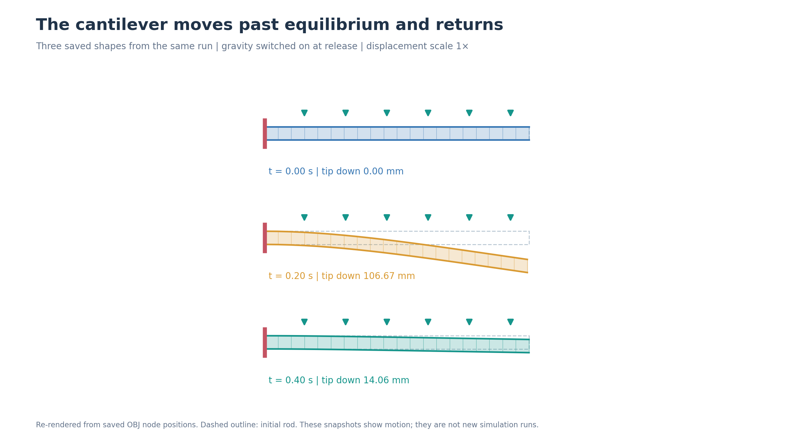

*Figure 9: Dynamic cantilever shapes at 0, 0.2, and 0.4 s, redrawn using the existing OBJ node positions. The left end remains fixed and gravity acts throughout; the dashed line shows the original shape, and displacement is shown at its actual scale.*

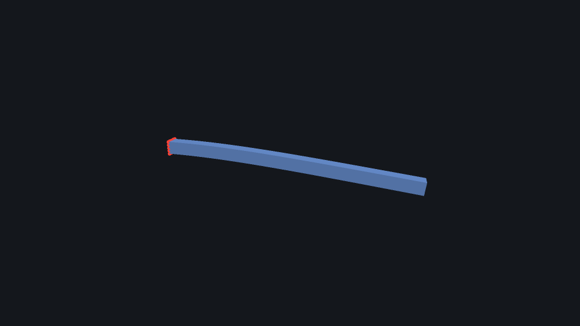

*Figure 10: Cantilever beam bending under gravity at physical time 1.0 s; the red nodes are at the fixed end.* [Watch the bending video](assets/s3-bend.mp4) (covering physical time 0–2 s, 51 frames, with a video duration of 2.04 s).

Next, keeping the same spatial mesh, I ran the first 2 s with $h=0.01$, $0.005$, and $0.0025\,\mathrm{s}$. The three trajectories are shown together:

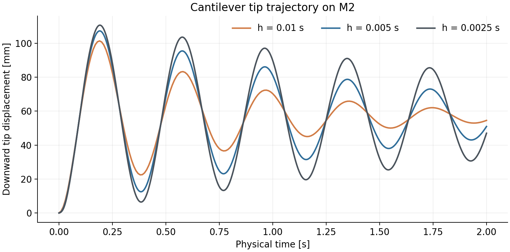

*Figure 11: Tip displacement on the M2 mesh for three time-step sizes; the corresponding physical time is 0–2 s.*

The table shows readings at four instants. Positions are in mm, with positive values indicating downward displacement:

| Time | $h=0.01$ s | $h=0.005$ s | $h=0.0025$ s |
|---|---:|---:|---:|
| 0.5 s | 63.453 | 68.150 | 70.836 |
| 1.0 s | 70.275 | 80.988 | 89.767 |
| 1.5 s | 52.331 | 42.404 | 32.128 |
| 2.0 s | 54.526 | 50.950 | 46.984 |

Using the displacement for $h=0.0025\,\mathrm{s}$ as the denominator, the relative differences for $h=0.005\,\mathrm{s}$ at the four instants are **3.79%, 9.78%, 31.99%, and 8.44%**, respectively. For example, at 1.5 s the two trajectories differ by about 10.276 mm; the reference trajectory's displacement is about 32.128 mm, near an oscillation trough.

In the subsequent experiment, I fixed each of the M2, M3, and M4 meshes and compared tip displacement over 0–0.5 s using four time steps: 0.005, 0.0025, 0.00125, and 0.000625 s. The earlier batch used `tol=1e-4`, while this refinement batch used `tol=1e-6`; results from the two batches at the same time step differed only in the last digits. Each mesh was sampled at 101 shared physical times, and the maximum absolute difference between each adjacent pair of time steps was then calculated:

| Mesh | 0.005 vs. 0.0025 s | 0.0025 vs. 0.00125 s | 0.00125 vs. 0.000625 s |
|---|---:|---:|---:|
| M2 | 6.047 mm | 3.349 mm | 1.856 mm |
| M3 | 8.348 mm | 4.333 mm | 2.150 mm |
| M4 | 7.795 mm | 4.279 mm | 2.379 mm |

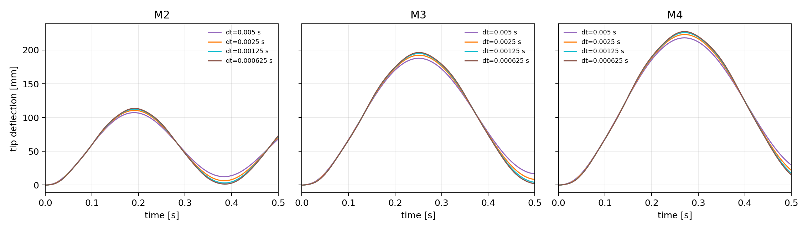

*Figure 12: Tip trajectories over 0–0.5 s for four time steps on each fixed spatial mesh, M2, M3, and M4. All three panels use the same vertical-axis scale.*

On all three meshes, the differences between adjacent trajectories decrease as the time step is halved. For M2, for example, the difference decreases from 6.047 mm to 3.349 mm and then to 1.856 mm, each time becoming about 55% of its previous value. The locally observed orders on the three meshes are about 0.85–1.01, consistent with the first-order time-discretization trend of implicit Euler.

Spatial resolution also affects oscillation amplitude. With $h=0.00125\,\mathrm{s}$, the first tip peaks for M2, M3, and M4 are about **112.5, 194.9, and 225.8 mm**, respectively, occurring at about **0.191, 0.251, and 0.271 s**. Thus, fixing the mesh and reducing the time step lets us isolate the effect of time discretization; switching meshes shows how spatial resolution changes the motion.

### Why is the amplitude larger with a finer time step?

In the linear oscillator at the beginning, a smaller time step retained more oscillation energy. We can now approximate the rod's main bending motion as a mass-spring oscillator to further calculate how numerical dissipation affects the peak. After a constant gravitational load is suddenly applied, it passes through the new equilibrium position and swings back. Let $q$ denote downward displacement, and let $m,k,F_g$ denote the equivalent mass, stiffness, and constant load, respectively. The linear single-mode model is:

$$
m\ddot q+kq=F_g,\qquad q(0)=\dot q(0)=0,
\qquad q_* = \frac{F_g}{k},\quad \omega=\sqrt{\frac{k}{m}}.
$$

The continuous solution is $q(t)=q_*[1-\cos(\omega t)]$: it oscillates around the static position $q_*$, and its downward displacement reaches $2q_*$ at the first lowest point. Applying implicit Euler to the same oscillator both rotates the oscillation phase at each step and multiplies the amplitude relative to equilibrium by $\rho<1$. At $t=nh$, it can be written directly as:

$$
q_h(t)=q_*\left[1-\rho^{t/h}\cos\left(\frac{t}{h}\theta\right)\right],
\qquad
\rho=(1+\omega^2h^2)^{-1/2},\quad \theta=\arctan(\omega h).
$$

The decay is even clearer from the discrete energy relation. Let $y=q-q_*$, and define $E_n=mv_n^2/2+ky_n^2/2$ about the new equilibrium position. The implicit Euler update satisfies:

$$
E_n-E_{n+1}
=\frac{m}{2}(v_{n+1}-v_n)^2
+\frac{k}{2}(y_{n+1}-y_n)^2\geq0.
$$

Even though the continuous model has no damping, the discrete update loses oscillation energy. For a fixed physical duration $T$, the retained amplitude fraction is approximately $\rho^{T/h}=\exp[-\omega^2Th/2+O(h^3)]$. Therefore, reducing the time step decreases numerical dissipation and retains more amplitude.

Taking the roughly **2.60 Hz** frequency from the long M2 trajectory as an example, the equation above gives amplitude retention fractions over 1 s of about **51.4%, 71.7%, 84.6%, and 92.0%** for the four time steps, respectively. These are amplitude fractions relative to the equilibrium position. In the saved dynamic cantilever trajectories, the first downward peak also changes in the same direction:

| Mesh | $h=0.005$ s | $h=0.0025$ s | $h=0.00125$ s | $h=0.000625$ s |
|---|---:|---:|---:|---:|
| M2 | 107.262 mm | 110.618 mm | 112.520 mm | 113.592 mm |
| M3 | 187.732 mm | 192.312 mm | 194.900 mm | 196.354 mm |
| M4 | 218.002 mm | 222.956 mm | 225.765 mm | 227.339 mm |

On each mesh, the first peak is larger with a finer time step, consistent with reduced implicit Euler dissipation. Across meshes, stiffness and the dominant vibration frequency also change, so M2, M3, and M4 must each be analyzed separately.

### Computing adjacent time-step trajectory differences with the same formula

This oscillator model gives the trajectory for each time step. Subtracting two trajectories lets us analyze the adjacent-step differences measured earlier. Here, we compare positions at the same physical instant, such as the results for $h=0.005\,\mathrm{s}$ and $h/2=0.0025\,\mathrm{s}$. Expanding $q_h(t)$ in the small time step gives:

$$
q_h(t)-q_{h/2}(t)
=\frac{q_*\omega^2t}{4}\,h\cos(\omega t)+O(h^2).
$$

The leading term is proportional to $h$ and gives the first-order leading term for the adjacent-trajectory difference of this oscillator. The discrete frequency corresponding to the phase is $\theta/h=\omega-\omega^3h^2/3+O(h^4)$; in this undamped linear example, amplitude error begins at first order, while phase error begins at second order.

At the 101 shared physical times, let $D(h)=\max_t|q_h(t)-q_{h/2}(t)|$, and define the local order as $p_{\mathrm{obs}}=\log_2[D(h)/D(h/2)]$. Recomputing from the original trajectory differences above gives **0.853 and 0.851** for the two intervals on M2, **0.946 and 1.011** on M3, and **0.865 and 0.847** on M4. These are time-convergence data for fixed spatial meshes and the current four time steps; overall, they are close to first order.

Next, I substituted the single-mode formula for the three meshes. The static scale $q_*$ is taken as each mesh's displacement in the static cantilever experiment, then multiplied by $5.90\times10^8/(4.40\times10^7)$, based on the small-deformation relation that displacement is inversely proportional to $E$, to represent the softer material in the dynamic cantilever experiment. M2 uses the dominant frequency of about 2.60 Hz from the long trajectory; M3 and M4 use the first-peak time at the finest time step to estimate the dominant frequency as $f\approx1/(2t_{\mathrm{peak}})$:

| Mesh | $q_*$ [mm] | $f$ [Hz] | Frequency source |
|---|---:|---:|---|
| M2 | 56.987 | 2.60000 | 10 s trajectory period |
| M3 | 99.328 | 1.99005 | First peak at 0.251250 s |
| M4 | 115.591 | 1.84758 | First peak at 0.270625 s |

This parameter set was fixed for each mesh and used at all four time steps. The frequencies for M3 and M4 were converted from the first peaks in the existing trajectories; the model therefore approximates the main vibration of the full rod. Sampling the closed-form solution at the same 101 times gives the following maximum adjacent-trajectory differences; each cell is “**single-mode calculation / simulation result**,” in mm:

| Mesh | 0.005 ↔ 0.0025 s | 0.0025 ↔ 0.00125 s | 0.00125 ↔ 0.000625 s |
|---|---:|---:|---:|
| M2 | 6.013 / 6.047 | 3.334 / 3.349 | 1.755 / 1.856 |
| M3 | 8.373 / 8.348 | 4.509 / 4.333 | 2.339 / 2.150 |
| M4 | 7.811 / 7.795 | 4.112 / 4.279 | 2.108 / 2.379 |

For the first pair of time steps, the difference between calculation and data is within 0.6% on all three meshes; for the finest pair, the M3 calculation is about 8.8% higher than the data, while the M4 calculation is about 11.4% lower. A model with just one vibration frequency and a linear static scaling already reproduces the direction and main magnitude of the shrinking trajectory differences. The remaining differences at finer steps also become apparent: for example, the single-mode local order for M4 approaches 1, while both measured intervals are about 0.85. The full rod has multiple modes and geometric nonlinearity, and each algebraic solve also has finite accuracy; these factors can be distinguished further by examining trajectory differences at each time instant.

| Symbol | Meaning |
|---|---|
| $q,q_h,q_*$ | Single-mode displacement, implicit Euler discrete displacement, and static displacement scale |
| $m,k,F_g$ | Equivalent modal mass, stiffness, and constant load |
| $f,\omega$ | Vibration frequency and angular frequency, $\omega=2\pi f$ |
| $\rho,\theta$ | Per-step amplitude retention factor and phase rotation angle |
| $y,v_n,E_n$ | Displacement relative to equilibrium, velocity at step $n$, and oscillation energy |
| $D(h),p_{\mathrm{obs}}$ | Maximum adjacent-time-step trajectory difference and local order computed from the adjacent-difference ratio |

Together, the static and dynamic cantilever changes can now be understood: spatial refinement adds bending degrees of freedom to the beam, time refinement reduces numerical dissipation in the oscillation, and the solver tolerance controls how each discrete equation solve terminates. These three factors correspond to spatial discretization, time discretization, and algebraic solution, and together determine the final trajectory.

<!-- Author's note: discussion of how to determine whether a simulation succeeded and the specific acceptance criteria. -->

## Rotating the other end of the rod

The bending above was driven by gravity, while the fixed end's position remained unchanged. Next, I move the driving action to the boundary and rotate one end of the rod by a prescribed angle. The torsion experiment uses the M2 square rod, with the same material and density as the dynamic cantilever experiment. One end is fixed, while the other rotates smoothly around the rod axis: from 0° to 90°, then it is held for a while. The entire process uses a 0.005 s time step for 500 steps, or 2.5 s.

Figure 13 marks the fixed and driven ends and overlays several cross-sections along the rod. Tracking the same material corner shows how the rotation is transmitted along the rod.

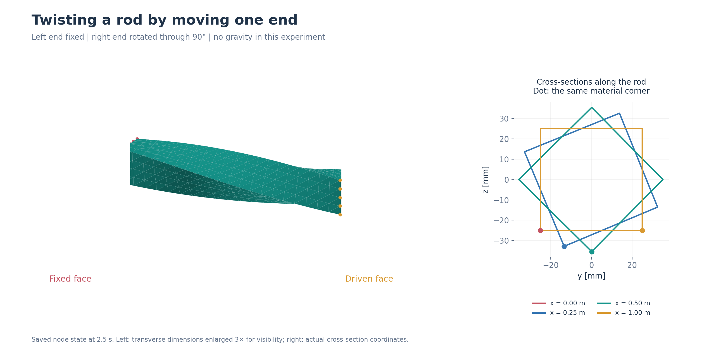

*Figure 13: Rod shape and four cross-sections in the saved final state. The transverse dimensions in the left image are magnified by a factor of 3 to make the twist visible; the right image shows the actual cross-section coordinates. Dots mark the same corresponding material corner on each cross-section.*

The driven end reaches angles of about 14.06°, 45°, 75.94°, and 90° at 0.5, 1.0, 1.5, and 2.0 s, respectively; the measured final angle is 89.99968°. During this motion, the maximum positional difference between the driven end and its target is about $3.72\times10^{-7}\,\mathrm{m}$, and the minimum volume ratio $J$ is 0.99045. Another run with the target angle increased to 180° also completed the full torsion process; I will not discuss that result here.

The motion of the driven end also provides an opportunity to observe the material torque response. In the final state of the 90° scene, the torques about the rod axis at the fixed and driven ends, calculated from the material gradient, are about $-82.460$ and $+82.465\,\mathrm{N\cdot m}$. The values are close and have opposite signs, reflecting the rod's response to the torsional drive. Recording 21 cross-sections along the rod shows the mean twist angle changing gradually from 0° at the fixed end to about 90° at the driven end.

*Figure 14: Final state after 90° torsion, at physical time 2.5 s.* [Watch the torsion video](assets/s3t-twist.mp4) (covering physical time 0–2.5 s, 51 frames, with a video duration of 2.55 s).

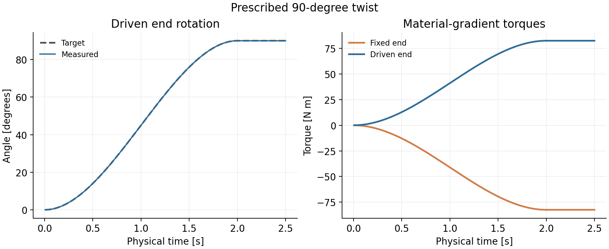

*Figure 15: Driven-end target and actual angles, and the torques at the fixed and driven ends calculated from the material gradient. The target and actual angles nearly overlap in the plot.*

## Replacing the rod with a ring

The stretching, bending, and torsion experiments all used regular square rods, making it easier to compare the effects of material and boundary conditions. Next, I change the geometry to a ring with a hole and observe how the same material and time-integration framework handles its overall motion. The ring experiment uses a torus mesh with 200 nodes and 491 tetrahedra. The material parameters are $E=10^6\,\mathrm{Pa}$, $\nu=0.3$, and density $1000\,\mathrm{kg/m^3}$; a small region at the top of the ring is fixed, and gravity is applied.

Figure 16 marks the fixed arc and the direction of gravity on the ring. The three instants use the same camera and scale, making the overall swinging motion easy to observe.

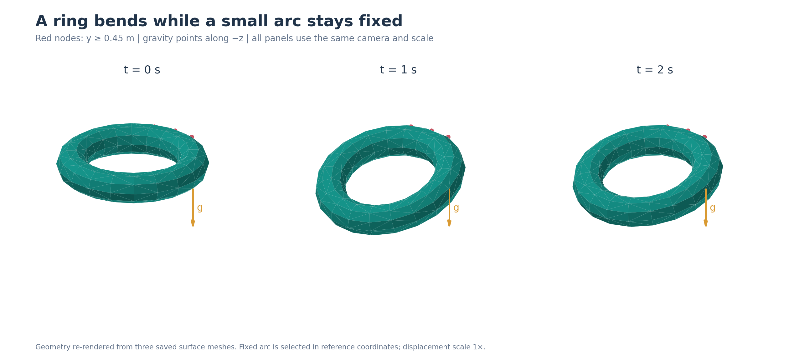

*Figure 16: Torus redrawn from the existing surface meshes at 0, 1, and 2 s. Red marks the 9 fixed nodes whose reference coordinates have y≥0.45 m; the arrow points in the actual -z gravity direction. Displacement is not magnified.*

First, I computed the fully loaded static shape from the reference shape: the solve took 13 Newton iterations, the maximum displacement was about 0.197 m, and the minimum volume ratio $J$ was about 0.871. Dynamic computation then started from the reference shape with zero velocity and advanced 400 steps of 0.005 s each, for a total of 2 s.

After the sudden loading, the ring swung downward. The maximum displacement recorded during the dynamic run was about 0.383 m, and the minimum volume ratio was about 0.765; the ring was still moving at 2 s, with a maximum recorded velocity component of about 1.106 m/s. This scene lets the same element material and integrator handle a perforated, non-rod-shaped mesh, while the motion changes from one-directional rod bending to the overall swinging of a ring.

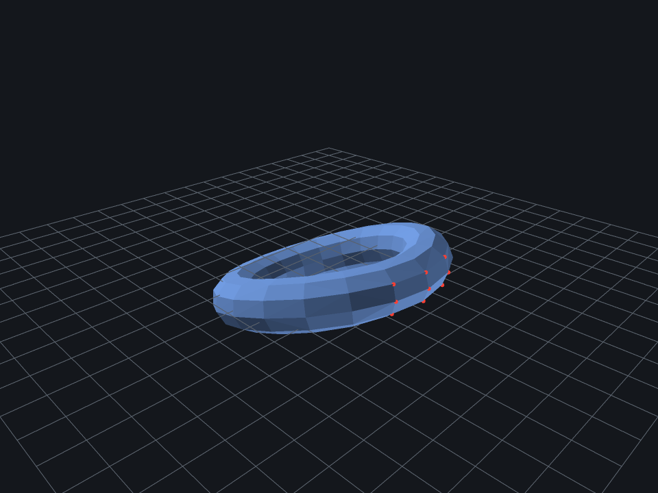

*Figure 17: Torus shape at physical time 1 s; red points mark the fixed region.* [Watch the torus video](assets/s4-torus.mp4) (covering physical time 0–2 s, 81 frames, with a video duration of 3.24 s).

## How much computing power and memory does a complex mesh need?

After the torus, I continued with meshes that have more detail and larger size. Along with the motion shape, we now need to consider computing resources: how do node count, element count, solve time, and memory scale?

Here, I use three Armadillo tetrahedral meshes of increasing size. All three use $E=10^7\,\mathrm{Pa}$, $\nu=0.3$, density $1000\,\mathrm{kg/m^3}$, a 0.005 s time step, and `tol=1e-2`. A subset of the nodes at the bottom of the model is fixed, and gravity is applied along $-z$. The meshes use the model's own coordinates; the Armadillo model's vertical axis is $+y$, so the load here acts laterally on the model. Each mesh advances 10 steps, corresponding to 0.05 s of physical time.

Figure 18 shows the reference geometry of the 54K mesh, its fixed bottom, and the coordinate directions, helping explain this lateral-loading setup.

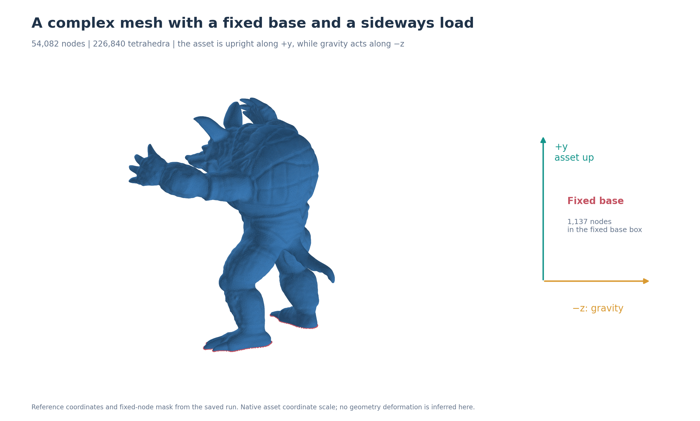

*Figure 18: Armadillo reference geometry and fixed nodes. Red marks the 1,137 fixed nodes in the record; the right side shows the model's own +y vertical direction and the actual -z load direction.*

| Mesh | Node count | Tetrahedron count | Recorded time for 10 steps | Peak RSS |
|---|---:|---:|---:|---:|
| Armadillo 13K | 13,230 | 54,985 | 14.82 s | about 274 MiB |
| Armadillo 28K | 27,951 | 121,190 | 34.44 s | about 606 MiB |
| Armadillo 54K | 54,082 | 226,840 | 71.765 s | about 1.084 GiB |

Peak RSS in the table refers to the process's peak resident memory. Each step in all three records used one Newton iteration. For the 54K mesh, the median per-step time was 7.173 s, and the minimum $J$ was about 0.9881. The 13K and 28K results came from the same batch; 54K came from a later independent run with slightly different recording. The table shows the computational scale in each record, rather than a strict benchmark: the measurements themselves incurred diagnostic and output overhead, and other tasks were running on the machine during the 13K and 28K measurements.

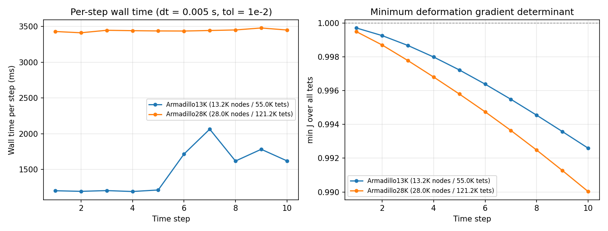

*Figure 19: Actual per-step time (left) and minimum volume ratio (right) for 10 steps in the 13K and 28K batches; the left plot uses milliseconds. The independent 54K run is listed in the table above.*

## Putting multiple bodies into one system

So far, the expansion has involved increasing the mesh size of a single body. Another direction is to increase the number of bodies, letting multiple meshes share one solve process. Here, I first place bodies that do not touch, assigning each its own global node indices, elements, boundary conditions, and position. A direct check is to make several translated copies of the same sphere, advance them in one global problem, and compare each trajectory against an independently simulated single body.

Figure 20 illustrates this replication with a four-body layout: each body retains its own local problem, and translation changes its position in global space; the corresponding matrices are also divided into uncoupled blocks by body.

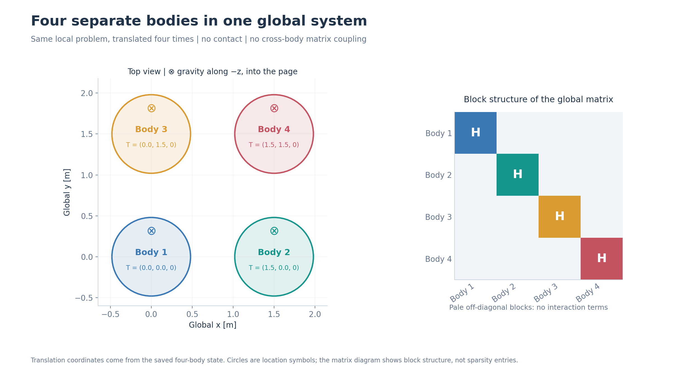

*Figure 20: Four-body translated layout and schematic structure of the global matrix. Translation vectors come from the saved state, and circles denote positions; gravity points into the image along -z. The right image shows the block structure by body, not actual sparse entries.*

The single-body mesh here has 1,760 nodes and 6,851 tetrahedra. Each instance uses the same material and constraints, changing only its initial position; the 1-, 4-, and 16-body cases each advance 10 steps with a time step of 0.005 s. The four-body scene has 7,040 nodes and 27,404 tetrahedra; the 16-body scene has 28,160 nodes and 109,616 tetrahedra.

| Scene | Comparison method | Maximum node-position difference |
|---|---|---:|
| 4 bodies | Four independent single-body runs, compared at the initial state and 10 time steps: 44 body-instant comparisons in total | $2.04\times10^{-10}$ m |
| 16 bodies | One independently solved single-body trajectory reused for 16 translated instances, for 176 body-instant comparisons in total | $2.18\times10^{-10}$ m |

For these independent copies of identical bodies, the force residual diagnostic uses the infinity norm of the free-node force residual. Replicating bodies does not automatically increase this scale, so the caller supplies the same single-body force scale (about 5086.259 N) for the homogeneous multi-body comparison, enabling instance-by-instance comparisons.

In the 16-body scene, there are no cross-body matrix coupling terms in either the initial or final state, and the number of cross-body tetrahedra is zero. For comparison, each instance's translation is subtracted before comparing local node positions; since the instances have the same material, mesh, and local loads, one independent single-body trajectory serves as the reference for all 16 local problems. The final positions were also independently recomputed.

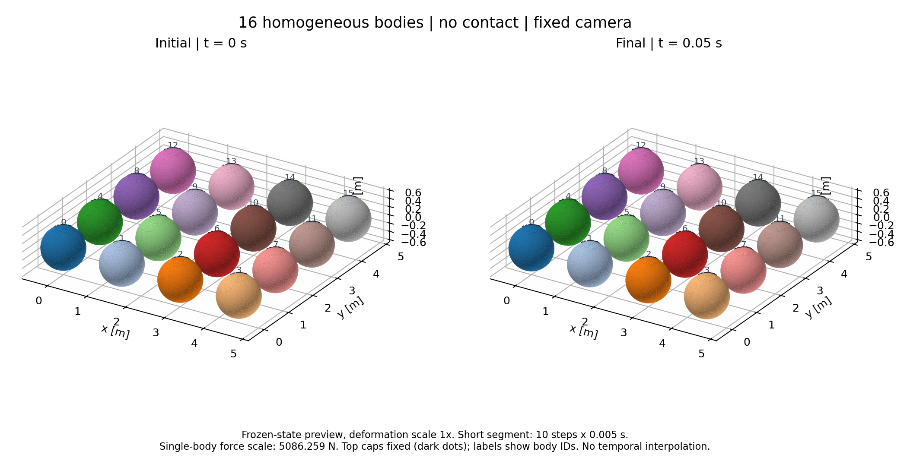

*Figure 21: Initial shape of the 16-body scene (left, 0 s) and shape at the end of step 10 (right, 0.05 s); colors distinguish the bodies, and deformation is shown at its actual scale.*

## From elements to scenes

Even in a multi-body scene, the basic structure from that initial time step remains. From a single tetrahedron to rods that bend and twist, and then to a ring, complex meshes, and multiple spheres, fiction has consistently used the basic structure “local energy → global assembly → solve for new positions.” Different experiments have shown me different aspects of this process: how material derivatives change with deformation, how time steps change oscillation trajectories, how meshes change bending shapes, and how much computing power and memory larger systems need.

These results also show that whether a simulation result is “correct” is not a simple yes-or-no conclusion. It depends on the discretization, time step, solver tolerance, and intended use. Recording the conditions, metrics, and limitations of every run is just as important as writing the program.

## Personal reflections

Looking back at the process from equations and code to experimental records, my most direct gain has been improved hands-on ability. When I used to read textbooks, understanding the derivation was enough; writing it as a program brought concrete issues such as mesh input, sparse matrix assembly, boundary conditions, linear solves, logs, and visualization. Turning an idea on paper into an experiment that can run and be reproduced is a different kind of skill.

After the program is written, small issues keep emerging during simulation: energy does not decrease, the residual stalls at an intermediate level, the mesh becomes badly distorted, a slightly larger time step causes divergence, or the result does not match theory. Most have no ready-made answer. I have to narrow down the possibilities, use theoretical analysis to judge which part is at fault, and then design controlled experiments to verify and resolve it. This process demands patience and a solid understanding of physics and numerical methods. Each time I trace a discrepancy to its root cause, my understanding of the method becomes a little more concrete.
