## 从教材走向自己的仿真器

　　学习物理仿真时，我一直好奇：教材里的运动方程，怎样才能变成真正可以运行的程序？以一根在重力作用下的杆为例，程序需要计算每个节点受到哪些力、材料产生了怎样的变形，又该怎样在每个时间步更新位置和速度。

　　我从 [Physics-Based Simulation](https://phys-sim-book.github.io/) 教材及其 [Python 教程](https://github.com/phys-sim-book/solid-sim-tutorial) 入手，先用二维质量-弹簧场景研究了计算开销，并把 Python、C++ 和不同求解路径的对照写成了[上一篇二维质量-弹簧 benchmark 文章](https://maojunxiang.divinechime64.chatgpt.site/zh/blog/physics-solver-benchmark/)。这些经验让我决定自己实现一个三维固体仿真器。

　　这里的“仿真器”指的是把连续介质的运动方程离散成计算机可以求解的代数方程，并逐步推进时间的程序。**fiction 就是这样一个主要用 C++20 编写的三维固体仿真器，目前专注于超弹性固体。** 它并不是一个通用有限元软件，而只是我在学习过程中做的一个实验性小项目，主要用来练手，把教材里的方法完整地跑通。

　　技术上，它把物体离散成四面体网格，为每个单元计算 Neo-Hookean 材料的能量、梯度和 Hessian（能量对节点坐标的二阶导数），再把这些局部贡献装配成全局系统。时间推进使用隐式 Euler，每一步通过 Projected Newton（投影牛顿法）和稀疏线性求解得到新的位置。它目前不处理接触、塑性和流体；特点是结构简单、易于修改，便于添加新材料、新场景和数值检查。

　　要看清这些部件如何协同，可以先跟着一个时间步走一遍，再把其中的材料计算和时间更新拆开检查。随后，让它们在一根杆上一起工作，从拉伸走到弯曲、扭转，最后换上更复杂的几何和多个物体。

## 从一个时间步看 fiction

　　想象一根左端固定、在重力作用下弯曲的杆。已知当前时刻每个节点的位置和速度，接下来要找出经过一小段时间后的形状。左端必须留在指定位置，其余节点既会因惯性继续运动，也受到弹性和重力的作用。fiction 如何把这些要求放进同一次计算？

　　把所有节点的位置和速度分别写成向量 $x^n$、$v^n$，时间步长记为 $h$。先只考虑惯性，让每个节点按当前速度走一步，得到惯性预测位置：

$$
\widetilde{x}=x^n+h v^n.
$$

　　这个预测位置为求解器提供了一个参照：如果没有其他力或边界约束，节点就会走到那里。弹性和重力则会把它拉向新的平衡。对动态场景，fiction 把新位置写成下面的优化问题：

$$
\Phi(x)=\frac{1}{2}(x-\widetilde{x})^T M(x-\widetilde{x})
+h^2\left(U_{\mathrm{elastic}}(x)+U_{\mathrm{gravity}}(x)\right)
+\Phi_{\mathrm{DBC}}(x).
$$

　　其中 $M$ 是集中质量矩阵。第一项衡量新位置偏离惯性预测的程度，第二项是带 $h^2$ 权重的弹性和重力势能，最后一项 $\Phi_{\mathrm{DBC}}$ 是指定位置边界条件（Dirichlet boundary condition，DBC）的罚项。这个目标函数对应隐式 Euler 的离散更新：惯性项把新位置拉向预测位置，势能项取新时刻的值。求解目标是找到一个使 $\Phi$ 取极小值的 $x$；实际计算中，只要满足设定的停止条件就结束迭代。得到 $x$ 后，再用 $v^{n+1}=(x-x^n)/h$ 更新速度。

　　先看一个可以手算的例子。假设只有一个不受约束的质点，竖直坐标向上，初始位置和速度都为零，除重力外不受其他力，重力加速度大小为 $9.81\,\mathrm{m/s^2}$。取 $h=0.005\,\mathrm{s}$，惯性预测位置仍然为零。把重力势能代入上式并求驻点，一步后的位置为 $-9.81h^2=-0.00024525\,\mathrm{m}$，即向下约 **0.245 mm**。

　　隐式 Euler 用新时刻的速度计算整个时间步的位移，因此第一步的下降量偏大；同样时间内，连续自由落体约下降 0.123 mm。两者不同并不奇怪：前者是固定时间步上的离散解，后者是该理想化问题的连续解。

　　图 1 把惯性预测、连续运动和隐式 Euler 的一步结果放在同一位移尺度上，可以直接看到三种位置的关系。

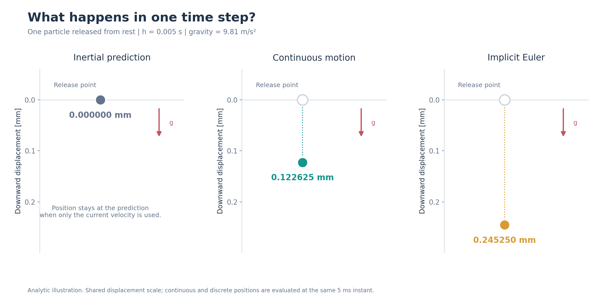

*图 1：从静止释放的质点在 5 ms 后的位置。三栏分别为惯性预测、连续自由落体和隐式 Euler 的解析计算结果，纵轴均为向下位移，单位 mm。*

　　真实的杆由许多四面体组成，节点之间通过材料能量相互影响，无法像单个质点那样直接写出答案。fiction 在当前形状下计算目标函数的梯度和 Hessian，求解线性方程得到一个更新方向，再用线搜索决定沿该方向走多远。如果试探位置不能使目标下降，程序就缩小线搜索步长后重试；接受一次更新后继续迭代，直到满足停止条件。

　　材料的大变形可能让原始 Hessian 出现负特征值，用它算出的搜索方向未必是下降方向。fiction 的 Neo-Hookean 四面体实现会对每个单元的局部 Hessian 做半正定（PSD）投影，再装配成全局稀疏矩阵。投影后的矩阵只用于计算更新方向，材料的能量和梯度仍由原来的材料模型给出。

　　固定端也需要参与求解。fiction 先对尚未达到目标位置的节点施加罚项；当节点误差满足设定条件后，再从求解方向中消去相应的自由度。固定端的目标位置保持不变；在扭转场景中，目标位置则可以随时间变化。如果求解过程中提高边界罚刚度，程序会重新计算目标值、搜索方向和约束满足情况，使三者始终对应同一个优化问题。每个时间步的求解还会记录迭代次数、停止原因和约束误差，便于检查这一步内部发生了什么。

| 符号 | 含义 |
|---|---|
| $x^n,v^n$ | 当前时间的位置和速度 |
| $h$ | 时间步长 |
| $\widetilde{x}$ | 按当前速度得到的惯性预测位置 |
| $M$ | 集中质量矩阵 |
| $U_{\mathrm{elastic}},U_{\mathrm{gravity}}$ | 弹性势能和重力势能 |
| $\Phi_{\mathrm{DBC}}$ | 指定位置边界条件的罚项 |

　　静态求解沿用同一框架，只是去掉惯性项，直接寻找给定载荷下的平衡形状。

## 把材料装进四面体

　　上面的时间步把惯性、材料和边界组合成了一个目标函数。其中，材料能量来自每个四面体的局部计算。一根三维杆由许多四面体拼成。对其中一个四面体，已知它在参考形状和当前形状下四个顶点的位置，由此可以构造变形梯度 $F$，用来描述单元从参考形状到当前形状的拉伸、剪切和旋转。Neo-Hookean 材料根据 $F$ 计算单元的弹性能量，各单元的贡献再按节点编号累加到全局系统。

　　材料需要提供能量值、梯度，以及组装求解矩阵所需的局部 Hessian。fiction 把这些操作组织在 `IEnergy` 接口中：材料负责描述局部物理响应，时间积分器负责把它与惯性、重力、边界条件组合起来。因此，检查一种新材料时可以分层进行：先验证单元本身，再观察它在一个完整时间步中的行为。

### 先检查单个单元和装配

　　具体检查从一个四面体开始：分别施加拉伸、剪切和压缩，用有限差分估算能量对节点位置的一阶、二阶导数，再与代码计算的梯度和原始 Hessian 对照。每种状态使用 $10^{-4}$ 到 $10^{-7}$ 的四档差分步长，共 12 组。梯度相对误差最大约为 $4.61\times10^{-8}$，Hessian 相对误差最大约为 $1.66\times10^{-8}$。

　　图 2 展示了这些检查所用的四面体构形：材料公式保持相同，改变的是四个顶点之间的相对位置。

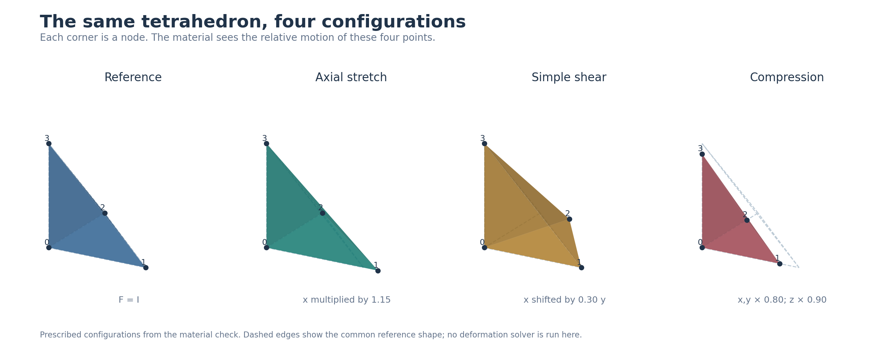

*图 2：参考、轴向拉伸、简单剪切与压缩构形。实心点表示当前节点，虚线表示共同的参考边；变形矩阵取自材料检查中的规定构形。*

　　这组检查还覆盖了参考形状上的平移和旋转、变形后叠加刚体旋转、不同杨氏模量和泊松比，以及两个四面体拼接后的装配。PSD 投影则单独核对：把投影矩阵与独立的特征分解重构结果对比，并确认剪切和压缩状态的原始 Hessian 确实出现负特征值；投影后只剩浮点舍入量级的负值。这样就能把材料真实的二阶导数和求解时采用的曲率近似分开观察。

### 用线性振子检查时间更新

　　单元检查考察了给定形状下的材料响应，接着还要看力如何通过时间更新改变运动。为此，我选了一个能写出参考轨迹的小系统：一个质量块连接在线性弹簧上，刚度取 20，质量分别取 1、2、5，时间步分别取 0.01、0.02、0.04 s，每组推进 120 步。参考轨迹由隐式 Euler 的更新公式从初态独立递推得到，再与程序输出的位置和速度逐步比较。九组中，累计位置差最大约为 $8.94\times10^{-15}$，速度差最大约为 $4.02\times10^{-14}$。

　　图 3 左侧画出这个振子的场景，右侧把已保存的位置和速度配成相轨迹。轨迹向内收缩，表示振荡能量逐渐减少。

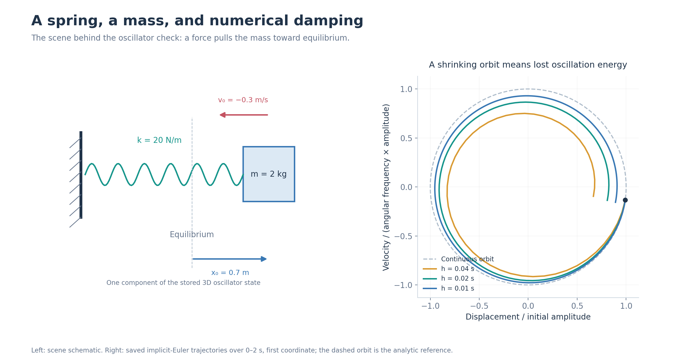

*图 3：弹簧振子的场景与相轨迹。右图取质量 2 kg 的第一坐标，在 0–2 s 内比较三档时间步；虚线圆为连续参考轨道，实线来自保存的数值轨迹。*

　　同一个振子也可以用来观察时间步对运动的影响。固定质量为 2，在 0–2 s 的区间内比较数值轨迹与连续振子解。时间步从 0.04 s 缩小到 0.02、0.01 s 时，区间内的最大无量纲状态误差依次约为 0.324、0.179、0.094；末态与初态的能量比则为 0.452、0.671、0.819。

　　这里的状态误差同时比较位置和速度。令 $\omega=\sqrt{k/m}$，用 $L_0=\max(\lVert x_0\rVert_\infty,\lVert v_0\rVert_\infty/\omega)$ 归一化位置，用 $\omega L_0$ 归一化速度，再在所有分量和采样时刻中取两类差异的最大值。步长越小，这个例子中保留的振荡能量越多。后面的动态悬臂也会展示时间步与振荡轨迹的关系。

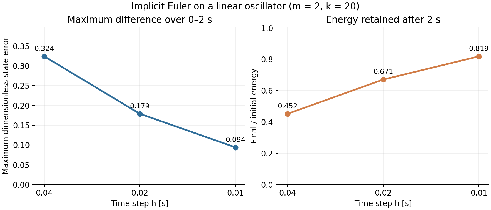

*图 4：线性振子在相同的 2 s 物理时长下，三档时间步对应的状态差异和能量比。横轴从左至右依次减半；左图为 0–2 s 采样区间内与连续振子解的最大无量纲状态差异，右图为 2 s 末态能量与初态能量之比。*

## 让一根杆均匀拉伸

　　材料的局部计算和简单系统的时间更新都检查过后，就可以把多个单元、全局装配和边界条件放到一起。这里先从均匀拉伸开始：我把材料放进一根长 1 m、截面为 0.05 m × 0.05 m 的三维杆中。杆采用 Neo-Hookean 材料，$E=10^6\,\mathrm{Pa}$、$\nu=0.3$；两端施加与均匀拉伸对应的位移边界，中间节点由求解器确定。轴向拉伸比依次设为 1.00、1.01、1.02 和 1.05，其中 1.00 表示未拉伸，1.05 表示伸长 5%。

　　图 5 展示四档拉伸的参考形状：右端逐步向外移动，横向尺寸也随规定的仿射目标缩小。

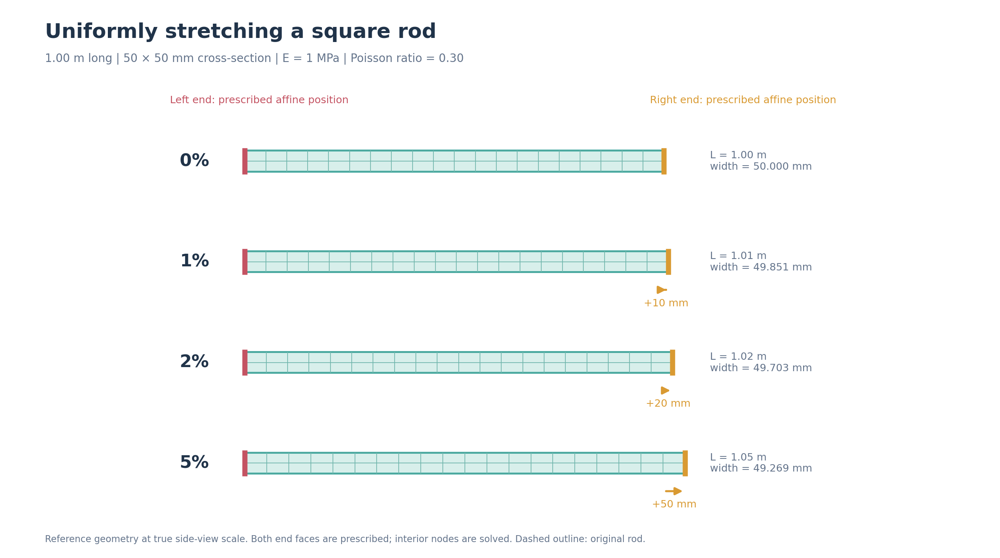

*图 5：四档均匀拉伸的参考几何，侧视比例保持一致。两端完整的仿射位置由边界指定，中部由求解器确定；横向尺寸使用运行记录中的参考伸长系数，虚线为原形。* [查看四档拉伸设置动图](assets/scenes/03-uniform-rod-stretch.gif)（按加载案例切换）。

　　我使用三张从粗到细的网格，依次记作 M1、M2、M3，分别包含 99、525、3321 个节点。每张网格都计算四档拉伸比，并比较位置、反力、能量和单元体积比。12 个网格与拉伸比组合都完成了这组检查；非零拉伸下的 Newton 迭代次数如下：

| 网格 | 1% 伸长 | 2% 伸长 | 5% 伸长 |
|---|---:|---:|---:|
| M1 | 18 | 20 | 14 |
| M2 | 21 | 24 | 15 |
| M3 | 23 | 24 | 16 |

　　M3 在三档非零拉伸下的最大能量相对差约为 $2.67\times10^{-8}$，最大反力相对差约为 $1.38\times10^{-8}$。前三档拉伸比使用 $10^8$ 的初始 DBC 罚刚度，5% 拉伸使用 $10^{10}$；求解过程中，罚刚度会根据边界满足情况调整。这组结果同时检验了材料计算、全局装配和两端位移边界。

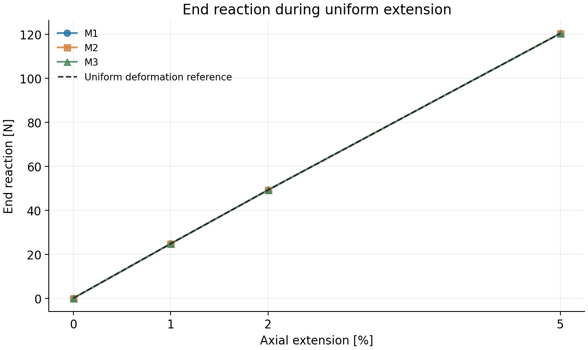

*图 6：均匀拉伸实验的轴向伸长与端部反力。M1、M2、M3 三组结果与均匀形变参考在图中基本重合；各点对应 0%、1%、2%、5% 伸长。*

## 悬臂梁的空间与时间实验

　　均匀拉伸中的位移是仿射变化，线性单元可以直接表达。弯曲则需要不同位置的拉伸、压缩和转动相互配合，更容易显出网格分辨率的影响。接下来仍用同样尺寸的方杆，分别观察空间网格和时间步怎样改变结果。

### 网格加密时，梁会弯下多少？

　　先从静态平衡开始。悬臂梁长 1 m，截面为 0.05 m × 0.05 m；左端固定，其余部分在重力作用下弯曲，直到达到平衡。梁采用 Neo-Hookean 材料，杨氏模量 $E=5.90\times10^8\,\mathrm{Pa}$、泊松比 $\nu=0.3$、密度 $1000\,\mathrm{kg/m^3}$。我关心自由端的平均向下位移，也就是尖端挠度。按小变形 Timoshenko 梁理论，在这组条件下尖端挠度约为 **10.002 mm**，其中包含弯曲和剪切两部分，可以作为一条对照线。

　　图 7 标出固定端、自由端和重力方向，并用三档保存状态展示梁在相同载荷下的形状。

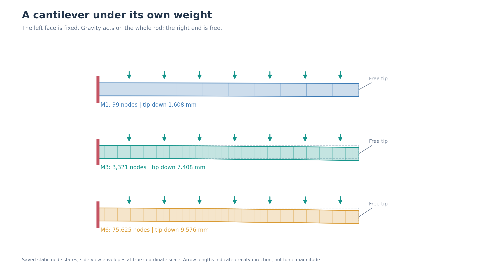

*图 7：静态悬臂的侧视轮廓。红线为固定端，箭头表示全杆所受的重力方向；三栏来自粗、中、细三档网格的保存节点状态，位移未放大。*

　　为了观察空间离散的影响，我把四面体网格从 M1 逐步加密到 M6。下面六组数据统一采用 `tol=1e-8`；相对差异定义为“尖端挠度与 10.002 mm 的差值，除以 10.002 mm”。

| 网格 | 节点数 | 四面体数 | 尖端挠度 | 相对梁参考差异 |
|---|---:|---:|---:|---:|
| M1 | 99 | 240 | 1.608 mm | 83.92% |
| M2 | 525 | 1,920 | 4.250 mm | 57.51% |
| M3 | 3,321 | 15,360 | 7.408 mm | 25.94% |
| M4 | 10,309 | 51,840 | 8.620 mm | 13.82% |
| M5 | 23,409 | 122,880 | 9.151 mm | 8.51% |
| M6 | 75,625 | 414,720 | 9.576 mm | 4.26% |

　　六档网格中，尖端位移随网格加密逐步增大，与梁理论参考的差异从 83.92% 降到 4.26%。例如，从 M3 加密到 M6，尖端挠度增加约 2.169 mm；从 M5 到 M6 增加约 0.425 mm。这说明四面体网格的分辨率会显著影响弯曲形状。

　　除了网格，我还记录了同一张 M3 网格在不同求解设置下的结果。最初的 M3 运行使用 `tol=1e-10`，在第 100 次迭代达到上限时，尖端位移为 7.40750851 mm，自由节点力残差的无穷范数约为 $1.23\times10^{-7}\,\mathrm{N}$。后续使用 `tol=1e-8`，尖端位移为 7.40750861 mm，两次结果相差约 $1.04\times10^{-10}\,\mathrm{m}$。

　　在改用 `combined` 停止判据后的 M3 对照中，第 6 次迭代结束时的尖端位移为 7.40750850694 mm，与最初一组末态的全节点最大位置差约为 $1.27\times10^{-12}\,\mathrm{m}$。迭代次数相差很大，得到的形状却几乎重合。下面分别讨论空间离散和停止判据的影响。

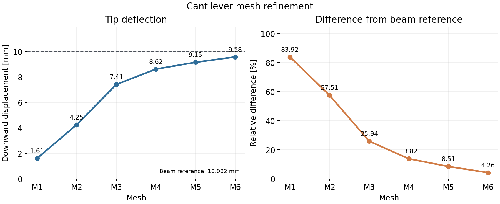

*图 8：六档静态悬臂网格的尖端挠度及相对梁参考差异；虚线为约 10.002 mm 的小变形梁参考。六组均来自 `tol=1e-8` 的网格细化批次。*

### 为什么粗网格里的梁更硬？

　　图 7 的形状和图 8 的挠度曲线指向同一个现象：网格越粗，梁的响应越硬。要理解它，可以从四面体怎样表示位移入手。fiction 使用 P1 四面体：位移在每个单元内按一次函数插值，因此单元内的变形梯度和小应变都是常量。弯曲则需要更丰富的空间变化。以沿 $x$ 方向、在 $xz$ 平面内作常曲率弯曲的一小段梁为例，位移可以写成：

$$
u_x=-\kappa xz,\qquad u_z=\frac{\kappa x^2}{2},
\qquad \varepsilon_{xx}=-\kappa z,
\qquad \gamma_{xz}=\frac{\partial u_x}{\partial z}+\frac{\partial u_z}{\partial x}=0.
$$

　　这里 $\kappa$ 是曲率，$z$ 是截面上的位置。梁的一侧受拉、另一侧受压；两项位移的导数还要恰好抵消，才能形成没有剪切的纯弯曲。单个线性四面体无法完整表达其中的二次项和交叉项，需要许多单元一起拼出这种形状。粗网格限制了可表达的位移模式，于是同样的重力只会产生较小的弯曲；增加单元后，梁逐渐变得容易弯曲。线性四面体在弯曲中偏硬、需要较细网格，这也是这类单元的一个常见特征。

　　静态悬臂实验直接求静态平衡：代码去掉惯性项，材料与重力势能的权重取 1。因此，这组挠度变化反映的是空间离散。前面 M3 两种 `tol` 的尖端差约为 $1.04\times10^{-10}\,\mathrm{m}$，同一网格与梁参考却相差约 $2.595\times10^{-3}\,\mathrm{m}$，两者量级相差约两千五百万倍。继续收紧这一次求解的停止容差，对弯曲形状的影响远小于增加空间自由度。

　　还可以问：这是不是“一阶收敛”？有限元中的“一阶单元”指插值多项式的次数为 1。对于光滑、稳定的标准问题，P1 单元在 $H^1$ 范数下通常随网格尺度一阶下降，在 $L^2$ 范数下二阶下降；这里测的是自由端节点平均位移，与这两种体域范数的定义不同。

　　令空间尺度 $h_s=L/n_x$，六张网格的轴向分段数 $n_x$ 依次为 10、20、40、60、80、120。把尖端与梁参考的绝对差记作 $e_i$，按 $p_{\mathrm{obs}}=\log(e_i/e_{i+1})/\log(h_{s,i}/h_{s,i+1})$ 计算，相邻网格之间的表观阶依次为 **0.55、1.15、1.55、1.68、1.71**。最后几段逐渐接近 1.7。

　　10.002 mm 参考由约 9.976 mm 的弯曲项和 0.026 mm 的剪切项组成，采用小变形 Timoshenko 梁近似；fiction 求解的是三维 Neo-Hookean 连续体，固定端也按三维节点施加约束。因此，这里的表观阶描述的是“相对这条梁参考线的差异如何下降”，其中同时包含网格效应和两种连续模型的差异，不能直接当作三维方程的收敛阶。

### 求解器何时结束这一次计算？

　　网格加密解释了形状为什么变化，前面的 M3 对照却还有另一个现象：形状已经几乎不变，求解器仍在迭代。这就需要回到每一次平衡求解内部，分别看搜索方向、实际移动和剩余力。

　　Newton 线性系统给出搜索方向 $p_N$；线搜索选择系数 $\alpha$，真正接受的位置变化是 $\Delta x=\alpha p_N$。如果目标函数在浮点精度下已很难继续下降，线搜索可能把 $\alpha$ 缩得很小，实际位置几乎不动，而原始搜索方向仍大于阈值。因此，“搜索方向小”和“实际移动小”回答的是两个不同的问题。实际移动很小也可能来自线搜索停滞，这时还需要看方程还剩多少未平衡的力。

　　动态目标中的材料和重力势能乘了 $h^2$。去掉 DBC 罚项、只取自由节点后，目标梯度为：

$$
g_f=\left[M(x-\widetilde{x})+h^2\nabla U(x)\right]_{\mathrm{free}},
\qquad
r_f=\frac{g_f}{h^2}
=\left[M\frac{v^{n+1}-v^n}{h}+\nabla U(x)\right]_{\mathrm{free}}.
$$

　　$r_f$ 是离散运动方程中的力残差，单位为 N；静态模式没有 $h^2$ 权重，此时直接取 $r_f=g_f$。这样，不同时间步长下的残差就能放在同一量纲上比较。此前的量纲检查中，$h=0.005$、$0.01$、$0.02\,\mathrm{s}$ 时，原始梯度的无穷范数分别为 $2.5\times10^{-5}$、$10^{-4}$、$4\times10^{-4}$，除以各自的 $h^2$ 后都得到 **1 N**。

　　当前实现提供四种停止模式，默认仍为 `step`。记 $S$ 为搜索方向条件、$A$ 为连续小位移条件、$G$ 为相对力残差条件，具体定义如下：

| 条件 | 定义 | 判定 |
|---|---|---|
| $S$ | 动态时 $\lVert p_N\rVert_\infty/h$；静态时 $\lVert p_N\rVert_\infty$ | 不超过 `tol` |
| $A$ | 已接受的 $\lVert\Delta x\rVert_\infty$ | 连续 `actualStepCount` 次不超过 `actualStepTol` |
| $G$ | $\lVert r_f\rVert_\infty/F_{\mathrm{scale}}$ | 不超过 `gradTolRel`，力尺度由 `gradScale` 传入 |

　　`step` 使用 $S$，`grad` 使用 $G$，`actual` 使用 $A$；`combined` 使用 **$S\ \mathrm{OR}\ (A\ \mathrm{AND}\ G)$**。四种模式都要求指定位置边界得到满足。这个“或”保留了原先“搜索方向足够小”的出口，又为“位置连续不再变化、剩余力也足够小”的状态增加了另一个出口；力残差检查属于后一个分支。

　　M3 对照保留原来的 `tol=1e-10`，并显式设置 `gradTolRel=1e-6`、`gradScale=24.525 N`、`actualStepTol=1e-12 m`、`actualStepCount=2`。这相当于给备用分支设置 $2.4525\times10^{-5}\,\mathrm{N}$ 的力残差阈值。第 6 次迭代的自由节点最大力残差约为 $1.23\times10^{-7}\,\mathrm{N}$，搜索方向指标仍约为 $1.06\times10^{-9}$；连续小位移和力残差条件使 `combined` 在这一状态结束。默认 `step` 则复现了原来的 100 次迭代记录。两次末态的位置重合到约 $10^{-12}\,\mathrm{m}$，尖端相对梁参考的差异仍约为 25.94%。

| 符号 | 含义 |
|---|---|
| $h_s,n_x$ | 空间网格尺度、轴向分段数；$h$ 仍表示时间步 |
| $u_x,u_z,\kappa$ | 理想弯曲位移的两个分量与曲率 |
| $\varepsilon_{xx},\gamma_{xz}$ | 小应变中的轴向正应变与工程剪应变 |
| $p_N,\alpha,\Delta x$ | Newton 搜索方向、线搜索系数、实际接受的位置变化 |
| $U,g_f,r_f$ | 弹性与重力总势能、自由节点目标梯度、自由节点物理力残差 |
| $F_{\mathrm{scale}}$ | 调用方提供的特征力尺度 |

　　这些设置与末态对照说明：停止判据改变的是求解过程何时结束，而不是空间离散误差本身。前者描述当前离散方程求到了什么状态，后者描述改变离散空间后形状如何变化。

### 缩小时间步后，弯曲轨迹怎样变化？

　　前面求的是静态平衡；接下来把时间推进加回来，观察杆的弯曲和回弹。动态悬臂实验沿用 1 m × 0.05 m × 0.05 m 的杆形几何，左端固定，在初始静止状态下突然施加重力。材料参数为 $E=4.40\times10^7\,\mathrm{Pa}$、$\nu=0.3$，密度仍为 $1000\,\mathrm{kg/m^3}$。我继续记录自由端的平均向下位移。

　　先用 M2 网格和 $h=0.005\,\mathrm{s}$ 推进 2000 步，模拟时长为 10 s。杆从参考形状开始向下弯曲，随后围绕平衡位置振荡；首个尖端峰值约为 **107.26 mm**，出现在 **0.190 s**，10 s 时尖端位移约为 **56.878 mm**。逐步记录显示，这 2000 步都满足当时使用的停止条件，固定端位置误差为 0，四面体体积比 $J$（当前体积与参考体积之比）的最小值约为 0.99314。

　　图 9 从最初一轮运动中选出三个时刻：杆从静止形状弯下，再向回摆动。后面的位移曲线记录的正是这个自由端的运动。

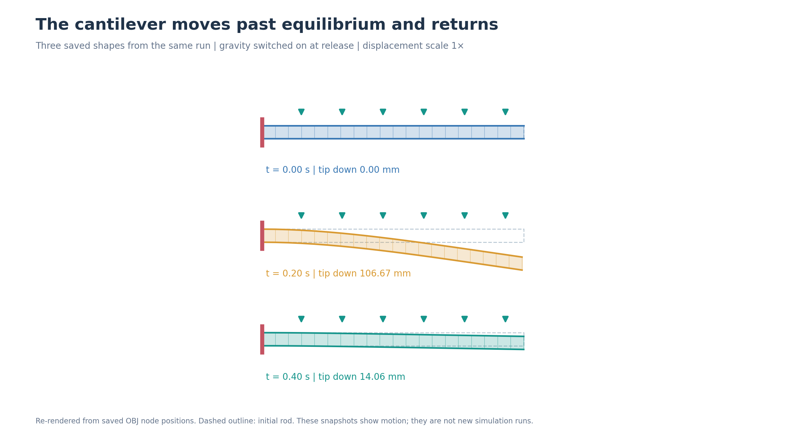

*图 9：动态悬臂在 0、0.2、0.4 s 的形状，按已有 OBJ 节点位置重绘。左端始终固定，重力持续作用；虚线为原形，位移按实际比例显示。*

*图 10：悬臂梁在重力下弯曲，画面为物理时刻 1.0 s；红色节点位于固定端。* [观看弯曲视频](assets/s3-bend.mp4)（覆盖物理时间 0–2 s，51 帧，视频时长 2.04 s）。

　　接着保持同一空间网格，分别用 $h=0.01$、$0.005$ 和 $0.0025\,\mathrm{s}$ 运行前 2 s。三条轨迹放在同一张图中：

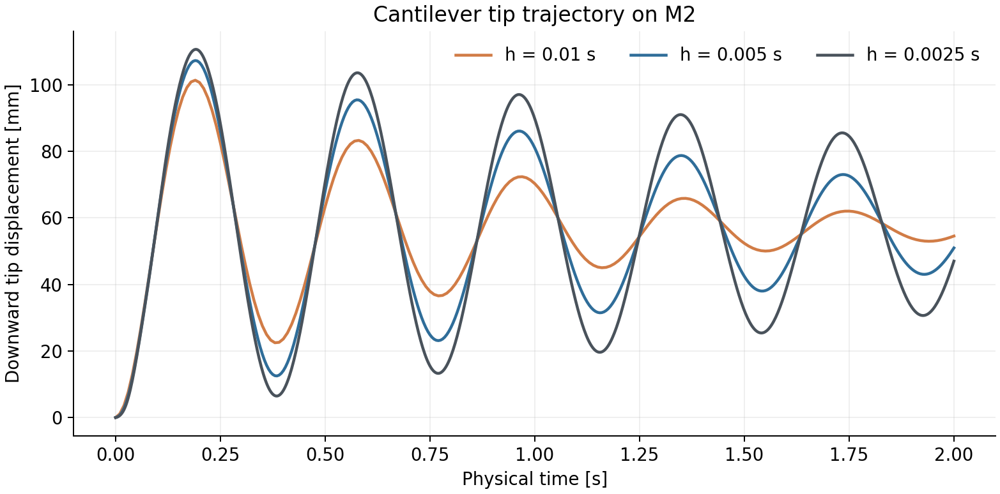

*图 11：M2 网格在前三档时间步下的尖端位移；对应物理时间为 0–2 s。*

　　再选取四个时刻读数，表中位置单位为 mm，正值表示向下：

| 时间 | $h=0.01$ s | $h=0.005$ s | $h=0.0025$ s |
|---|---:|---:|---:|
| 0.5 s | 63.453 | 68.150 | 70.836 |
| 1.0 s | 70.275 | 80.988 | 89.767 |
| 1.5 s | 52.331 | 42.404 | 32.128 |
| 2.0 s | 54.526 | 50.950 | 46.984 |

　　以 $h=0.0025\,\mathrm{s}$ 的位移为分母，$h=0.005\,\mathrm{s}$ 在四个时刻的相对差分别为 **3.79%、9.78%、31.99%、8.44%**。例如，1.5 s 时两条轨迹相差约 10.276 mm；此时参照轨迹的位移约为 32.128 mm，正处在振荡的低谷附近。

　　在后续实验中，我分别固定 M2、M3、M4 三张网格，使用 0.005、0.0025、0.00125 和 0.000625 s 四档时间步，比较 0–0.5 s 的尖端位移。前一批使用 `tol=1e-4`，这一细化批次使用 `tol=1e-6`；两批在相同时间步下的结果只有末位差别。每张网格都在 101 个共同的物理时刻取样，再计算相邻两档时间步之间的最大绝对差：

| 网格 | 0.005 与 0.0025 s | 0.0025 与 0.00125 s | 0.00125 与 0.000625 s |
|---|---:|---:|---:|
| M2 | 6.047 mm | 3.349 mm | 1.856 mm |
| M3 | 8.348 mm | 4.333 mm | 2.150 mm |
| M4 | 7.795 mm | 4.279 mm | 2.379 mm |

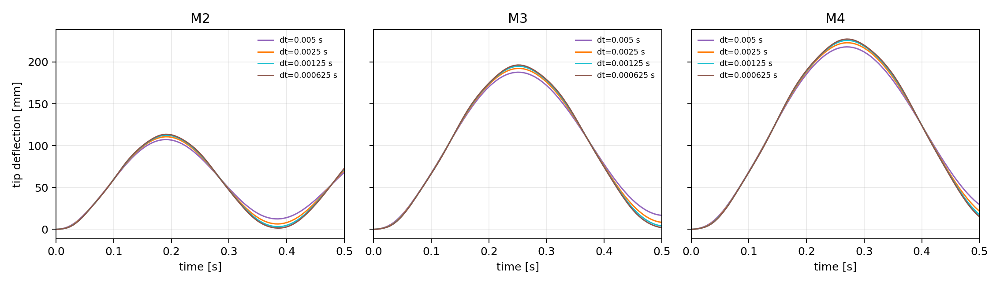

*图 12：M2、M3、M4 各自固定空间网格后，四档时间步的 0–0.5 s 尖端轨迹。三个面板使用同一纵轴尺度。*

　　三张网格上的相邻轨迹差都随时间步减半而下降。以 M2 为例，6.047 mm 减小到 3.349 mm，再减小到 1.856 mm，每次约缩小到原来的 55%。三张网格得到的局部观测阶数约为 0.85–1.01，与隐式 Euler 的一阶时间离散趋势相容。

　　空间分辨率同时影响振荡幅度。以 $h=0.00125\,\mathrm{s}$ 为例，M2、M3、M4 的首个尖端峰值依次约为 **112.5、194.9、225.8 mm**，峰值时刻约为 **0.191、0.251、0.271 s**。因此，固定网格、缩小时间步，可以单独观察时间离散的影响；换用不同网格，则能看到空间分辨率如何改变运动形状。

### 时间步更细，振幅为什么反而更大？

　　在开头的线性振子中，较小的时间步保留了更多振荡能量。现在把杆的主要弯曲运动也近似为一个质量-弹簧振子，就能进一步计算数值耗散怎样影响峰值。突然施加恒定重力后，它会越过新的平衡位置，再向回摆动。用 $q$ 表示向下位移，$m,k,F_g$ 分别表示等效质量、刚度和恒定载荷，线性单模态模型为：

$$
m\ddot q+kq=F_g,\qquad q(0)=\dot q(0)=0,
\qquad q_* = \frac{F_g}{k},\quad \omega=\sqrt{\frac{k}{m}}.
$$

　　连续解为 $q(t)=q_*[1-\cos(\omega t)]$：它围绕静态位置 $q_*$ 振荡，第一次到达最低点时，向下位移达到 $2q_*$。对同一振子采用隐式 Euler，每一步既旋转振动的相位，也把相对于平衡位置的振幅乘上 $\rho<1$。在 $t=nh$ 时可以直接写出：

$$
q_h(t)=q_*\left[1-\rho^{t/h}\cos\left(\frac{t}{h}\theta\right)\right],
\qquad
\rho=(1+\omega^2h^2)^{-1/2},\quad \theta=\arctan(\omega h).
$$

　　这种衰减从离散能量关系看得更直观。令 $y=q-q_*$，以新平衡位置为中心定义 $E_n=mv_n^2/2+ky_n^2/2$，隐式 Euler 的更新满足：

$$
E_n-E_{n+1}
=\frac{m}{2}(v_{n+1}-v_n)^2
+\frac{k}{2}(y_{n+1}-y_n)^2\geq0.
$$

　　即使连续模型没有阻尼，离散更新也会损失振荡能量。固定物理时长 $T$ 后，振幅保留比例近似为 $\rho^{T/h}=\exp[-\omega^2Th/2+O(h^3)]$。因此，缩小时间步会减少数值耗散，保留更多振幅。

　　以 M2 长轨迹中约 **2.60 Hz** 的频率为例，上式给出的 1 s 内振幅保留比例，在四档时间步下依次约为 **51.4%、71.7%、84.6%、92.0%**。这是围绕平衡位置的振幅比例。已保存的动态悬臂轨迹中，首个向下峰值也按同样方向变化：

| 网格 | $h=0.005$ s | $h=0.0025$ s | $h=0.00125$ s | $h=0.000625$ s |
|---|---:|---:|---:|---:|
| M2 | 107.262 mm | 110.618 mm | 112.520 mm | 113.592 mm |
| M3 | 187.732 mm | 192.312 mm | 194.900 mm | 196.354 mm |
| M4 | 218.002 mm | 222.956 mm | 225.765 mm | 227.339 mm |

　　同一网格上，时间步越细，首峰越大，这与减少隐式 Euler 耗散的方向一致。跨网格时，刚度和主要振动频率也会变化，因此 M2、M3、M4 需要分别计算响应。

### 用同一个公式计算相邻时间步的轨迹差

　　这个振子模型给出了每一档时间步的轨迹。将两条轨迹相减，就能继续分析前面测量的相邻步差。这里比较同一物理时刻两条轨迹的位置，例如 $h=0.005\,\mathrm{s}$ 与 $h/2=0.0025\,\mathrm{s}$ 的结果。将 $q_h(t)$ 按小时间步展开，有：

$$
q_h(t)-q_{h/2}(t)
=\frac{q_*\omega^2t}{4}\,h\cos(\omega t)+O(h^2).
$$

　　主项与 $h$ 成正比，给出了这个振子相邻轨迹差的一阶主项。相位对应的离散频率为 $\theta/h=\omega-\omega^3h^2/3+O(h^4)$；在这个无阻尼线性例子里，振幅误差从一阶开始，相位误差从二阶开始。

　　在 101 个共同物理时刻上，记 $D(h)=\max_t|q_h(t)-q_{h/2}(t)|$，局部阶为 $p_{\mathrm{obs}}=\log_2[D(h)/D(h/2)]$。由前面的原始轨迹差复算，M2 的两段为 **0.853、0.851**，M3 为 **0.946、1.011**，M4 为 **0.865、0.847**。这些是固定空间网格、当前四档步长下的时间收敛数据，整体接近一阶。

　　进一步把单模态公式代入三张网格。静态尺度 $q_*$ 取各网格在静态悬臂实验中的位移，再按小变形下位移与 $E$ 成反比的关系乘以 $5.90\times10^8/(4.40\times10^7)$，以对应动态悬臂实验较软的材料。M2 使用长轨迹中约 2.60 Hz 的主频；M3、M4 使用最细时间步的首峰时刻，以 $f\approx1/(2t_{\mathrm{peak}})$ 估计主频：

| 网格 | $q_*$ [mm] | $f$ [Hz] | 频率来源 |
|---|---:|---:|---|
| M2 | 56.987 | 2.60000 | 10 s 轨迹周期 |
| M3 | 99.328 | 1.99005 | 0.251250 s 首峰 |
| M4 | 115.591 | 1.84758 | 0.270625 s 首峰 |

　　每张网格固定这一组参数用于全部四档步长。M3、M4 的频率来自现有轨迹的首峰换算，模型据此近似描述完整杆的主要振动。用闭式解在相同的 101 个时刻取样，得到下面的最大相邻轨迹差；每格为“**单模态计算 / 仿真结果**”，单位 mm：

| 网格 | 0.005 ↔ 0.0025 s | 0.0025 ↔ 0.00125 s | 0.00125 ↔ 0.000625 s |
|---|---:|---:|---:|
| M2 | 6.013 / 6.047 | 3.334 / 3.349 | 1.755 / 1.856 |
| M3 | 8.373 / 8.348 | 4.509 / 4.333 | 2.339 / 2.150 |
| M4 | 7.811 / 7.795 | 4.112 / 4.279 | 2.108 / 2.379 |

　　三张网格第一组计算与数据的差异均在 0.6% 以内；最细一组中，M3 计算值比数据高约 8.8%，M4 低约 11.4%。只保留一个振动频率、用线性静态缩放构造的模型，已经重现了轨迹差缩小的方向和主要量级。较细步长下的剩余差异也逐渐显现，例如 M4 的单模态局部阶向 1 靠近，而实际两段都约为 0.85。完整杆具有多模态和几何非线性，每一步的代数求解也只能达到有限精度；这些因素可以继续通过逐时刻的轨迹差加以区分。

| 符号 | 含义 |
|---|---|
| $q,q_h,q_*$ | 单模态位移、隐式 Euler 离散位移、静态位移尺度 |
| $m,k,F_g$ | 等效模态质量、刚度与恒定载荷 |
| $f,\omega$ | 振动频率与角频率，$\omega=2\pi f$ |
| $\rho,\theta$ | 每一步的振幅保留因子与相位转角 |
| $y,v_n,E_n$ | 相对平衡位置的位移、第 $n$ 步速度与振荡能量 |
| $D(h),p_{\mathrm{obs}}$ | 相邻时间步轨迹的最大差、由相邻差比值计算的局部阶 |

　　至此，静态悬臂与动态悬臂的变化可以连起来理解：空间加密增加了梁的弯曲自由度，时间加密减少了振荡中的数值耗散，求解容差则控制每一次离散方程求解的结束方式。这三类因素分别对应空间离散、时间离散和代数求解，叠加在一起决定了最终轨迹。

<!-- 作者补充位置：怎样判断仿真成功，以及具体验收标准的讨论。 -->

## 让杆的另一端转起来

　　前面的弯曲由重力驱动，固定端的位置始终不变。接下来把驱动放到边界上，让杆的一端按指定角度旋转。扭转实验使用 M2 方杆，材料和密度与动态悬臂实验相同；一端固定，另一端绕杆轴平滑旋转：从 0° 转到 90°，再保持一段时间。整个过程使用 0.005 s 的时间步，共 500 步、2.5 s。

　　图 13 标出固定端和驱动端，并把沿杆长的几个截面叠在一起。跟踪同一个材料角点，就能看出转角如何沿杆传递。

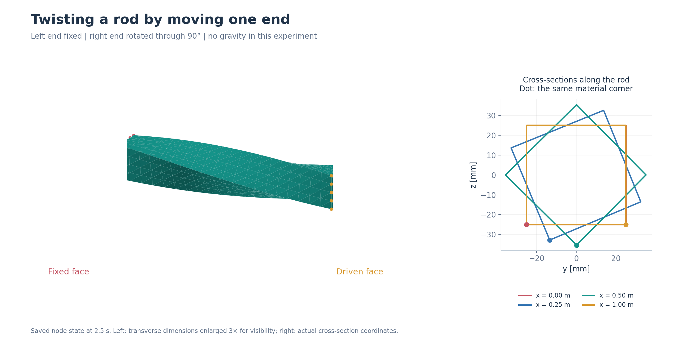

*图 13：保存末态中的杆形和四个截面。左图横向尺寸放大 3 倍以看清扭转，右图为实际截面坐标；圆点标识各截面上对应的同一个材料角点。*

　　驱动端的角度在 0.5、1.0、1.5、2.0 s 依次达到约 14.06°、45°、75.94°、90°，末态实测为 89.99968°。这段运动中，驱动端相对目标的最大位置差约为 $3.72\times10^{-7}\,\mathrm{m}$，最小体积比 $J$ 为 0.99045。另一组运行把目标转角扩大到 180°，也完成了整个扭转过程；本文不展开这组结果。

　　驱动端的运动也提供了观察材料力矩响应的机会。在 90° 场景的末态，按材料梯度计算，固定端和驱动端绕杆轴的力矩约为 $-82.460$ 和 $+82.465\,\mathrm{N\cdot m}$。两端数值接近、方向相反，反映了杆对扭转驱动的响应。沿杆长记录 21 个截面时，平均扭转角从固定端的 0° 逐渐变化到驱动端的约 90°。

*图 14：90° 扭转末态，物理时刻为 2.5 s。* [观看扭转视频](assets/s3t-twist.mp4)（覆盖物理时间 0–2.5 s，51 帧，视频时长 2.55 s）。

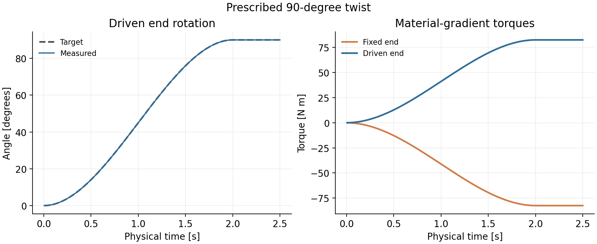

*图 15：驱动端目标角与实际角，以及按材料梯度计算的固定端和驱动端力矩。目标角与实际角在图中基本重合。*

## 把杆换成一个圆环

　　拉伸、弯曲和扭转都使用了规整的方杆，便于对照材料和边界的作用。接下来把几何换成带孔的圆环，观察同一套材料和时间积分框架怎样处理它的整体运动。圆环实验使用一个 torus（圆环体）网格：200 个节点、491 个四面体。材料参数为 $E=10^6\,\mathrm{Pa}$、$\nu=0.3$、密度 $1000\,\mathrm{kg/m^3}$；固定圆环顶部的一小段区域，再施加重力。

　　图 16 把固定的小弧段和重力方向标在圆环上，三个时刻使用同一相机和尺度，便于观察整体摆动。

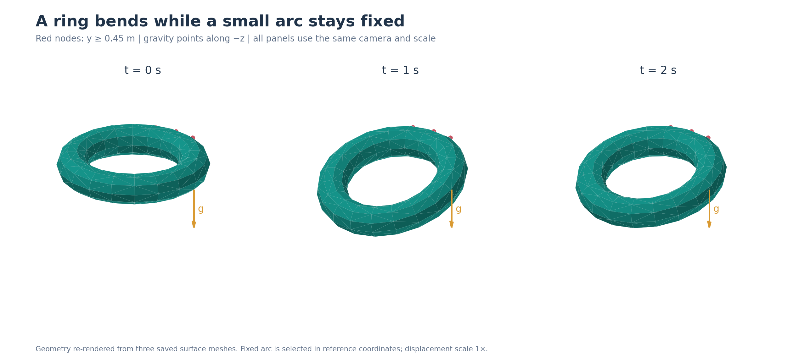

*图 16：根据已有 0、1、2 s 曲面网格重绘的圆环。红色为参考坐标 y≥0.45 m 的 9 个固定节点，箭头沿实际的 -z 重力方向；位移未放大。*

　　先从参考形状计算静态满载形状：求解经过 13 次 Newton 迭代，最大位移约为 0.197 m，最小体积比 $J$ 约为 0.871。随后从参考形状和零速度开始动态计算，以 0.005 s 为一步推进 400 步，即 2 s。

　　圆环在突然加载后向下摆动，动态过程中记录到的最大位移约为 0.383 m，最小体积比约为 0.765；2 s 末圆环仍在运动，记录到的最大速度分量约为 1.106 m/s。这个场景让同一套单元材料与积分器处理一张带孔、非杆状的网格，画面也从单方向的杆弯曲变成了圆环的整体摆动。

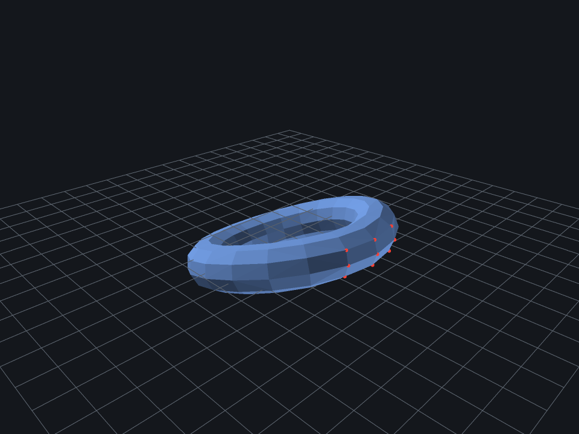

*图 17：圆环在物理时刻 1 s 的形状；红色点标识固定区域。* [观看圆环视频](assets/s4-torus.mp4)（覆盖物理时间 0–2 s，81 帧，视频时长 3.24 s）。

## 复杂网格需要多少计算资源？

　　圆环之后，我继续换上细节更多、规模更大的网格。除了运动形状，这时还需要关注计算资源：节点、单元、求解时间和内存会增长到什么量级？

　　这里选用三档 Armadillo 四面体网格。三档都使用 $E=10^7\,\mathrm{Pa}$、$\nu=0.3$、密度 $1000\,\mathrm{kg/m^3}$、0.005 s 时间步和 `tol=1e-2`，固定模型底部的一部分节点，并施加沿 $-z$ 方向的重力。网格采用模型自带的坐标；Armadillo 模型的竖直轴是 $+y$，所以这里的载荷沿模型侧向作用。每档推进 10 步，对应 0.05 s 的物理过程。

　　图 18 展示 54K 网格的参考几何、固定底部和坐标方向，帮助理解这次侧向加载的设置。

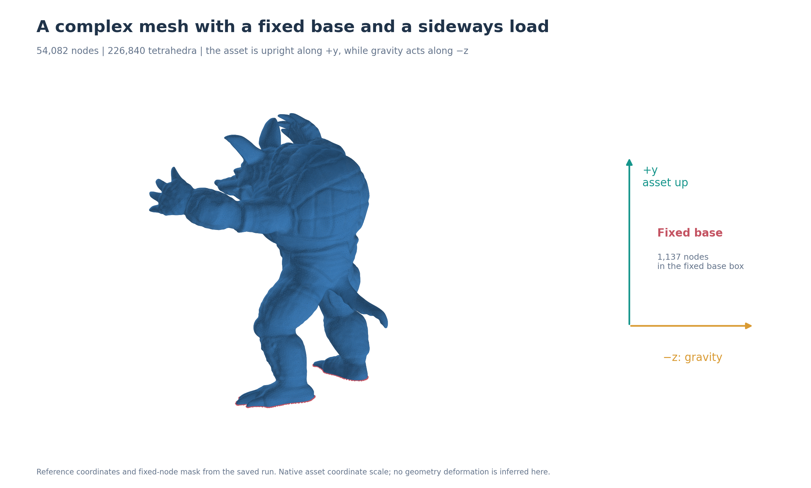

*图 18：Armadillo 的参考几何与固定节点。红色标出记录中的 1,137 个固定节点；右侧说明模型自身的 +y 竖直方向和实际 -z 载荷方向。*

| 网格 | 节点数 | 四面体数 | 10 步记录时间 | 峰值 RSS |
|---|---:|---:|---:|---:|
| Armadillo 13K | 13,230 | 54,985 | 14.82 s | 约 274 MiB |
| Armadillo 28K | 27,951 | 121,190 | 34.44 s | 约 606 MiB |
| Armadillo 54K | 54,082 | 226,840 | 71.765 s | 约 1.084 GiB |

　　表中的峰值 RSS 指进程的峰值常驻内存。三档记录中，每步都使用 1 次 Newton 迭代。54K 这一档的逐步时间中位数为 7.173 s，最小 $J$ 约为 0.9881。13K 和 28K 来自同一批运行；54K 来自后续独立运行，记录方式略有不同。上表呈现的是各次记录的计算量级，并非严格的基准测试：测量本身带有诊断与输出开销，13K 和 28K 测量时机器上还有其他任务。

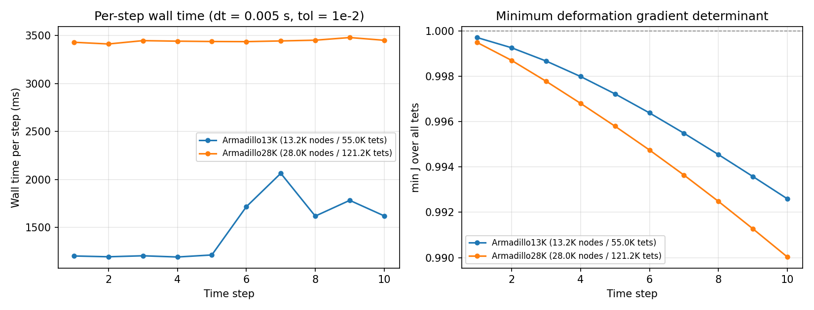

*图 19：13K 与 28K 批次各 10 步的逐步实际耗时（左）与最小体积比（右）；左图单位为毫秒。54K 的独立运行记录列在上表。*

## 把多个物体放进同一个系统

　　前面增加的是单个物体的网格规模。另一个扩展方向是增加物体数量，让多个网格共享同一个求解流程。这里先放入互不接触的物体，为各自安排全局节点编号、单元、边界条件与位置。一个直接的检查方式是：把同一个球体平移复制成多份，在同一个全局问题中推进，再把每一份的轨迹与独立单体比较。

　　图 20 用四体布局说明这种复制：每个物体保留自己的局部问题，平移改变它在全局空间中的位置；相应矩阵也按物体分成互不耦合的块。

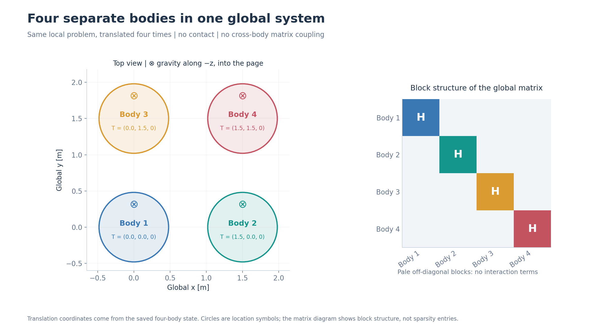

*图 20：四体平移布局与全局矩阵的结构示意。平移向量取自保存状态，圆形为位置符号；重力沿 -z 指向图内。右图表示按物体分块的关系，不表示实际稀疏条目。*

　　这里的单体网格有 1,760 个节点、6,851 个四面体。每个实例使用相同材料和约束，只改变初始位置；1、4、16 体分别推进 10 步，时间步为 0.005 s。四体场景共有 7,040 个节点、27,404 个四面体；16 体场景共有 28,160 个节点、109,616 个四面体。

| 场景 | 对照方式 | 最大节点位置差 |
|---|---|---:|
| 4 体 | 四次独立单体运行，在初始和 10 个时间步共 44 个物体-时刻比较 | $2.04\times10^{-10}$ m |
| 16 体 | 一次独立求解的单体轨迹，复用于 16 个平移实例，共 176 个物体-时刻比较 | $2.18\times10^{-10}$ m |

　　对这些相同物体的独立复制，力残差诊断使用自由节点力残差的无穷范数。复制物体并不会自动增大这个尺度，因此同质多体对照由调用方传入同一个单体尺度（约 5086.259 N），便于逐实例比较。

　　在 16 体场景中，初态和末态都不存在跨物体的矩阵耦合项，跨体四面体数量也为零。对照时先减去每个实例的平移，再比较局部节点位置；因为实例的材料、网格和局部载荷相同，一条独立单体轨迹就能作为这 16 份局部问题的对照。末态位置也经过了独立复算。

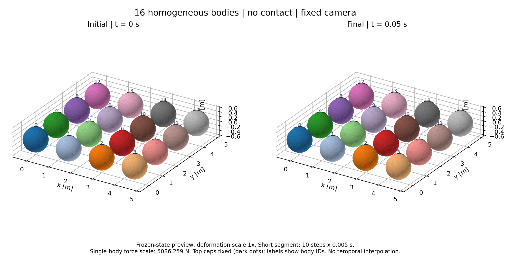

*图 21：16 体场景的初始形状（左，0 s）和第 10 步形状（右，0.05 s）；颜色区分物体，变形按实际比例显示。*

## 从单元到场景

　　走到多体场景，最初那个时间步的基本结构仍然保留着。从单个四面体，到会弯曲和扭转的杆，再到圆环、复杂网格和多个球体，fiction 始终沿用“局部能量 → 全局装配 → 求解新位置”的基本结构。不同实验则让我看到这个过程的不同侧面：材料导数如何随形变改变，时间步如何改变振荡轨迹，网格如何改变弯曲形状，以及更大的系统需要多少计算资源。

　　这些结果也说明，仿真结果的“正确”并不是非黑即白的结论。它取决于离散方式、时间步长、求解容差和具体用途。把每次运行的条件、指标和局限记录下来，和把程序写出来同样重要。

## 个人心得

　　回看这段从公式、程序到实验记录的过程，最直接的收获是动手能力的提高。以前读教材，公式推导看懂就够了；真正把它写成程序，才会遇到网格读入、稀疏矩阵装配、边界条件、线性求解、日志与可视化这些具体问题。让一个想法从纸面变成能运行、能复现的实验，是另一种能力。

　　写出程序之后，仿真过程中还会不断冒出小问题：能量不降、残差停在一个不上不下的量级、网格被压坏、时间步稍大就发散、结果和理论对不上。它们大多没有现成答案，只能先缩小范围，用理论分析判断问题出在哪一环，再设计对照实验去验证并解决。这个过程很考验耐心，也很考验对物理和数值方法的理解。每查清一个偏差的根因，我对这套方法的认识就更具体一点。
